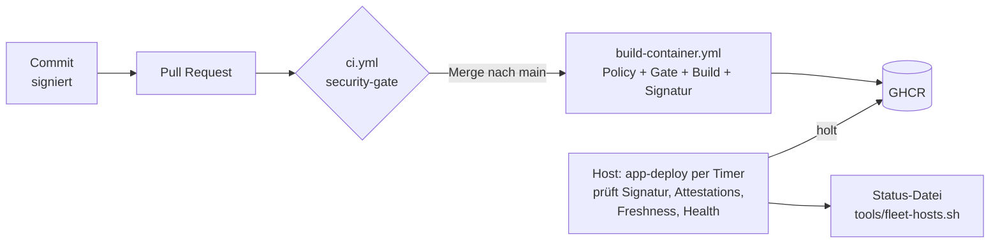

# security-pipeline

Zentrale, wiederverwendbare DevSecOps-Pipeline für alle Repos der Organisation
**Pascal-Organisation**. Jedes Projekt ruft diese Workflows mit ein paar Zeilen auf –
Sicherheits-Gates, Tool-Versionen und Policies werden hier einmal gepflegt und gelten
überall.

> **v2.0.0.** Ein Weg für Releases, ein Weg für Deploys. Tools lassen sich hier zentral tauschen:
> [docs/switching-tools.md](docs/switching-tools.md). Neues Projekt anbinden:
> [docs/new-project.md](docs/new-project.md). Stand: `tools/fleet-status.sh` (Repos),
> `tools/fleet-hosts.sh` (was wirklich auf den Hosts läuft).

---

## Überblick



**Die Grundidee:** Der Host akzeptiert nur Images, die `build-container.yml` signiert hat. Dieser
Workflow signiert erst, nachdem Release-Policy und Gate in ihm selbst gelaufen sind. Eine gültige
Signatur beweist also, dass beides lief, auch ohne Schutz von `main`.

| | **öffentlich** | **privat** |
|---|---|---|
| Runner | GitHub-hosted (erzwungen) | eigener Runner, Label `ci`; Signieren GitHub-hosted |
| SAST | CodeQL | Semgrep (+ Bandit für Python) |
| Signatur | Cosign keyless | Cosign keyless (Repo- und Workflow-Name stehen im öffentlichen Rekor-Log, Code nicht) |
| Merge | `security-gate` ist Pflicht (Ruleset) | nicht blockierbar (GitHub Free), aber **kein Release ohne Gate und gemergten PR** |

| Profil | Für | Deploy |
|---|---|---|
| `ci-only` | Code ohne Deploy | – |
| `container-pull` | alles auf eigenen Hosts, auch statische Seiten als nginx-Image | Host holt per `app-deploy` |
| `static-ftps` | Shared Hosting ohne eigene Prüfung | `deploy-static.yml` prüft Gate und `main`, dann FTPS |

Die Sichtbarkeit kommt nie aus einem Input: Der erste Job fragt die API, und ohne Antwort läuft
nichts. Fork-PRs können die eigenen Runner so nie erreichen.

---

## Die Workflows

### `ci.yml` – Gate für jeden PR und Push

| Schritt | Tool | Was es tut | Gate |
|---|---|---|---|
| Workflow-Lint | **actionlint** | Syntax, Typen, Expressions, Shellcheck in `run:` | jeder Fehler |
| Workflow-Security | **zizmor** | Template-Injection, gefährliche Trigger, zu breite Permissions, ungepinnte Actions | ≥ medium |
| Secrets | **TruffleHog** | sucht Secrets im Diff (PR/Push) bzw. der ganzen Historie (Schedule) und prüft, ob sie noch gültig sind | verified + unknown |
| SAST öffentlich | **CodeQL** | Datenfluss-Analyse (`security-extended`), Ergebnisse im Security-Tab | – (Alerts) |
| SAST privat | **Semgrep CE** | Regel-basiert, `p/default` | Severity ERROR |
| SAST Python privat | **Bandit** | Python-spezifisch (subprocess, pickle, yaml.load, …) | high / confidence ≥ medium |
| Dependencies + IaC | **Trivy fs** | CVEs in Lockfiles, Fehlkonfigurationen (Dockerfile, Terraform, …), Lizenzen | fixable HIGH/CRITICAL |
| Dockerfile | **hadolint** | Best Practices für Dockerfiles | error |

### `build-container.yml` – Release eines Images (nur `main`)

1. **Release-Policy:** Commit liegt auf `main`, ist verifiziert und das Merge-Ergebnis eines PRs
2. **Gate:** dieselbe `ci.yml` wie im PR
3. `docker build` mit OCI-Labels (`created` ist Pflicht: Replay-Schutz auf dem Host)
4. **Trivy image** – Gate: fixable HIGH/CRITICAL + eingebettete Secrets
5. **Syft** – SBOM im **CycloneDX**-Format
6. Push nach `ghcr.io/pascal-organisation/<repo>` – genau das gescannte Tar, kein Rebuild
7. **SLSA-v1-Provenance** – ehrlich eingeordnet: Build **L1 + Signatur**. L2/L3 bräuchte Provenance
   von der Build-Plattform selbst.
8. **Cosign keyless:** Signatur + Attestations auf einem GitHub-hosted Runner, ohne Repo-Code und
   ohne Scanner

Der Host prüft auf genau diese Workflow-Identität. Deshalb darf die Datei nicht ohne die
Überlappung aus [docs/switching-tools.md](docs/switching-tools.md) umbenannt werden.

### `deploy-static.yml` – Shared Hosting (privat)

Für Ziele, die selbst nichts prüfen können. Vor dem Upload prüft der Workflow selbst, dass der
Commit auf `main` liegt und `Security / security-gate` grün ist, und untersucht das Artefakt (nur
Dateien/Ordner, keine Links, keine `..`). Dann lädt er per FTPS hoch, **nie mit Löschen**. `ssh` als
Transport bleibt nur, bis `pascalhaag-website` umgezogen ist.

### `dast.yml` – von außen gegen die laufende Seite

- **OWASP ZAP Baseline**: spidert passiv – Header, Cookies, CSP, Info-Leaks
- **Nuclei**: Templates für Fehlkonfigurationen, offene Dateien/Panels, TLS, bekannte CVEs
  (rate-limited, ohne intrusive/fuzz-Templates)

Gate: ZAP High bzw. Nuclei high/critical. Ein Scan, der nicht läuft (ZAP-Exit ≥ 3, Nuclei
ohne geladene Templates), ist **kein** Pass. Templates sind auf ein Release gepinnt
(Renovate hält es aktuell). DAST läuft immer auf GitHub-hosted Runnern – die Ziele sind
öffentlich, und die CI-VM braucht so keinen Egress zu beliebigen Seiten. Mit Staging (z. B. websiteghana
`/release-test`) **vor** dem Produktiv-Deploy, sonst direkt danach gegen live.

### `image-rescan.yml` – wöchentlicher Re-Scan

Scannt `ghcr.io/<repo>:latest` mit frischen CVE-Daten (per `schedule:` aufrufen). Überbrückt
die Zeit bis Dependency-Track: neue fixable HIGH/CRITICAL in bereits ausgerollten Images
werden sichtbar.

Bekannte Grenzen: Der Re-Scan checkt kein Repo aus, Ausnahmen aus `.security/exceptions.json`
gelten hier also nicht. Und er scannt `:latest`, nicht zwingend den Digest, der auf dem
Host läuft (nach einem Rollback sind das zwei verschiedene Images). Noch ruft ihn kein Repo auf.

### Deploy-Status

`app-deploy` schreibt nach jedem Lauf `/var/lib/app-deploy/<app>.json` (Version, laufender Digest,
Ergebnis, Fehler). `tools/fleet-hosts.sh` vergleicht das mit dem neuesten Image. Grün in GitHub heißt
nur: Das Release ist fertig. Ob es läuft, steht dort.

---

## Nutzung

Aufrufer pinnen die Workflows **per Commit-SHA** (mit Versions-Kommentar), Renovate hält
sie aktuell:

```yaml
jobs:
  security:
    uses: Pascal-Organisation/security-pipeline/.github/workflows/ci.yml@<sha> # v1.0.0
    permissions:          # Obergrenze für die verschachtelten Jobs
      contents: read
      actions: read         # nur CodeQL (öffentlich) nutzt das
      security-events: write
    with:
      private-runner: '["self-hosted","ci"]'
      python-paths: "src"
      dockerfile: Dockerfile
```

GitHub prüft die `permissions` des Aufrufers gegen **jeden** verschachtelten Job –
auch gegen Jobs, die übersprungen werden (CodeQL, keyless Signing in privaten Repos).
Der Aufrufer gibt deshalb eine Obergrenze an; jeder Job hier deklariert selbst nur das,
was er braucht. Für `build-container.yml` heißt das: `contents: read`, `actions: read`,
`security-events: write`, `pull-requests: read`, `packages: write`, `id-token: write`.

Vollständige Beispiele: `solar` (öffentlich), `bahnbot` (privat), `websiteghana` (FTPS).

## Umsetzung in den Repos

`fleet/repos.json` hält fest, welches Repo welches Profil und welchen Rollout-Ring hat und
wo es bewusst abweicht. Den tatsächlichen Stand liest `tools/fleet-status.sh` live von
GitHub; eine Tabelle von Hand wäre nach Stunden veraltet.

### Der Vertrag

Rulesets und Release-Workflows setzen nur einen Check voraus:
**`Security / security-gate`** (der Aufrufer-Job heißt dafür `Security`). Die Jobs darunter
heißen nach Fähigkeiten (`Secrets`, `SAST (private)`, `Dependencies & IaC` …), nicht nach
Tools. Was zum Vertrag gehört und wie man ein Tool tauscht:
[docs/switching-tools.md](docs/switching-tools.md).

### Secrets

Repos mit `container-pull` brauchen keine: Der Host holt selbst. Nur `static-ftps` hält
`FTP_HOST`, `FTP_USER`, `FTP_PASS`. Auf privaten Hosts liegt ein Lese-Login für GHCR in
`/etc/app-deploy/docker/config.json` (root, 0600).

---

## Runner

| Rolle | Labels in den Workflows | genutzt von | Netz |
|---|---|---|---|
| CI (VM 110) | `ci` | `homelab`, `knowledgebase`, `workingrepo`, `tickets` | ausgehend nur GitHub, Registries, Paketquellen, semgrep.dev |
| CI, eigener Runner pro Repo | `pascalhaag-website`, `websiteghana`, `bahnbot` | das jeweilige Repo | wie `ci` |
| Deploy (VM 111) | `pascalhaag-website-deploy`, `websiteghana-deploy`, `tickets-deploy` | nur Deploy-Jobs des jeweiligen Repos | nur zu den Zielhosts (+ GitHub) |
| GitHub-hosted | `ubuntu-24.04` | alle **öffentlichen** Repos, DAST und Re-Scan auch für private | – |

Regeln: CI- und Deploy-Runner auf getrennten VMs, beide per Proxmox-Firewall vom LAN
getrennt; Self-hosted Runner nie für öffentliche Repos freigeben. Der Signier-Job von
`tickets` läuft derzeit auf `ci`, also auf derselben VM wie Builds und Tests (siehe Grenzen).

**Grenzen, offen benannt:**
- Die Runner sind **persistent**, nicht pro Job neu (Stand laut homelab- und
  websiteghana-Doku). Arbeitsverzeichnis, Docker-Daemon, Images und Build-Cache bleiben
  zwischen Jobs und Repos bestehen; Zugriff auf den Docker-Socket ist faktisch root auf der
  VM. Gegenmaßnahmen hier: `docker build --pull`, Trivy-Cache pro Run, Scanner als
  Runner-User, `persist-credentials: false`. Sauber wird es erst mit einer frischen VM pro
  Job (Proxmox-Template klonen).
- TruffleHog kann ohne Egress zu den Providern nichts verifizieren – Funde sind dann
  `unknown` und blockieren (gewollt, aber laut).
- zizmor und Bandit werden per pip **ohne Hashes** installiert (Version gepinnt). Das
  digest-gepinnte zizmor-OCI-Image braucht x86-64-v2. Die VMs 110/111 laufen laut
  websiteghana-Doku seit 05.10. mit CPU-Typ `host` – das Image sollte dort also laufen;
  Umstellung steht noch aus.

## Host-Setup (Container-Apps)

```bash
install -m 0755 deployer/app-deploy /usr/local/sbin/app-deploy    # danach: tools/fleet-hosts.sh --upgrade <tag>
install -d -m 0755 /etc/app-deploy
install -m 0644 deployer/app.conf.example /etc/app-deploy/<app>.conf   # anpassen
# privates Image: Lese-Login, nur für root
install -d -m 0700 /etc/app-deploy/docker
DOCKER_CONFIG=/etc/app-deploy/docker docker login ghcr.io -u <konto>
```

- systemd-Timer ruft `/usr/local/sbin/app-deploy <app>` auf.
- Voraussetzungen: `cosign` ≥ v3, `jq`, Docker Compose v2, `flock`.
- Lokal: `SSH_ORIGINAL_COMMAND=status|rollback|unhold /usr/local/sbin/app-deploy <app>`.

## Ausnahmen

Akzeptierte Findings gehören in `.security/exceptions.json` im jeweiligen Repo – immer mit
Begründung und Ablaufdatum. Das Format hängt an keinem Scanner, siehe
[docs/switching-tools.md](docs/switching-tools.md#ausnahmen).

## Lokal: pre-commit & signierte Commits

`templates/pre-commit-config.yaml` → als `.pre-commit-config.yaml` ins Repo
(gitleaks, actionlint, zizmor, hadolint, Basis-Checks).

```bash
git config --global gpg.format ssh
git config --global user.signingkey ~/.ssh/id_ed25519.pub
git config --global commit.gpgsign true
```

## Renovate

`renovate/default.json` ist das gemeinsame Preset: pinnt Actions und Images auf
Digests, aktualisiert auch `image:tag@sha256` in `run:`-Zeilen und Skripten (was
Dependabot nicht kann), regeneriert gehashte pip-compile-Locks (wöchentlich), wartet 3 Tage nach einem Release und
merged kleine Updates selbst als PR, sobald alle Checks grün sind. Ausgenommen: Majors und
Minor-/Major-Sprünge von Laufzeit-Images (python, php, node, …) – die kommen immer als PR zur
Durchsicht. Die eigenen Workflows laufen in Ringen: `workingrepo` und
`anmeldungunihandball` sofort, alle anderen nach 3 Tagen, Majors immer von Hand. Pro Repo:

```json
{ "extends": ["local>Pascal-Organisation/security-pipeline//renovate/default"] }
```

## Roadmap

- **Dependency-Track** (self-hosted): SBOMs aller Releases, Alarm bei neuen CVEs in
  bereits deployten Versionen
- **Harbor** statt GHCR: Registry-seitig unsignierte Images ablehnen
- Org-Rulesets für öffentliche Repos (signierte Commits, required checks)
- **Statische Deploys absichern (vorgezogen):** Signatur fürs Artefakt (`cosign sign-blob`)
  und Prüfung im Receive-Skript; bei FTPS verwaiste Dateien melden (bisher bleibt eine
  versehentlich veröffentlichte Datei dauerhaft live, weil nie gelöscht wird)
- **CodeQL als Gate** in öffentlichen Repos: Code-Scanning-Merge-Protection per Ruleset
  (kostenlos für öffentliche Repos)
- **Signierte Commits in privaten Repos prüfen:** CI-Check per `git verify-commit` gegen
  eine `allowed_signers`-Datei (Rulesets kosten bei privaten Repos)
