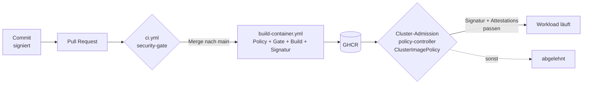

# security-pipeline

Zentrale, wiederverwendbare DevSecOps-Pipeline für alle Repos der Organisation
**Pascal-Organisation**. Jedes Projekt ruft diese Workflows mit ein paar Zeilen auf –
Sicherheits-Gates, Tool-Versionen und Policies werden hier einmal gepflegt und gelten
überall.

> **v3.0.0.** Kein Docker-Daemon mehr in CI-Jobs: Alle Tools kommen aus **einem** digest-gepinnten
> Image (`ci-toolbox`), Images baut rootless BuildKit in ein OCI-Tar, das gescannt und byte-identisch
> gepusht wird. Deployt wird per **Cluster-Admission** statt per Host-Agent: Der Cluster nimmt nur Images an,
> die `build-container.yml` (gepinnt auf Commit) signiert hat. Signierte SBOMs gehen an Dependency-Track.
> Tools lassen sich hier zentral tauschen: [docs/switching-tools.md](docs/switching-tools.md). Neues Projekt
> anbinden: [docs/new-project.md](docs/new-project.md). Stand: `tools/fleet-status.sh` (Repos).

---

## Überblick



**Die Grundidee:** Der Cluster akzeptiert nur Images, die `build-container.yml` signiert hat. Dieser
Workflow signiert erst, nachdem Release-Policy und Gate in ihm selbst gelaufen sind. Eine gültige
Signatur beweist also, dass beides lief, auch ohne Schutz von `main`.

| | **öffentlich** | **privat** |
|---|---|---|
| Runner | GitHub-hosted (immer: öffentlicher Code läuft nie auf eigenen Servern) | CI-Cluster (Kubernetes, ARC-Scale-Set `arc-ci`, ein frischer Pod pro Job); Signieren GitHub-hosted |
| SAST | CodeQL | Semgrep (+ Bandit für Python) |
| Signatur | Cosign keyless | Cosign keyless (Repo- und Workflow-Name stehen im öffentlichen Rekor-Log, Code nicht) |
| Merge | `security-gate` ist Pflicht (Ruleset) | nicht blockierbar (GitHub Free), aber **kein Release ohne Gate und gemergten PR** |

| Profil | Für | Deploy |
|---|---|---|
| `ci-only` | Code ohne Deploy | – |
| `container-pull` | alles, was im App-Cluster läuft, auch statische Seiten als nginx-Image | Cluster-Admission prüft die Signatur; Updater holt das Image |
| `static-ftps` | Shared Hosting ohne eigene Prüfung | `deploy-static.yml` prüft Gate und `main`, dann FTPS |

Die Sichtbarkeit kommt nie aus einem Input: Der erste Job fragt die API, und ohne Antwort läuft
nichts. Fork-PRs können die eigenen Runner so nie erreichen.

---

## v3: kein Docker-Daemon in Jobs

Alle Tools (Trivy, Syft, TruffleHog, actionlint, zizmor, hadolint, shellcheck, Semgrep, Bandit, Cosign,
crane und rootless BuildKit) stecken in **einem** Image: `ghcr.io/pascal-organisation/ci-toolbox`
([`toolbox/Dockerfile`](toolbox/Dockerfile), gebaut, gescannt und keyless signiert von
`.github/workflows/toolbox.yml`). Die Tools werden aus ihren offiziellen, per Digest gepinnten Images
kopiert, das Toolbox-Image bringt also kein neues Vertrauen mit. Die Workflows pinnen die Toolbox per
Digest in genau einer Variable (`TOOLBOX`, Renovate hält sie aktuell).

| | CI-Cluster (privat) | GitHub-hosted (öffentlich) |
|---|---|---|
| Wo laufen die Tools? | Der Runner-Pod **ist** die Toolbox (`TOOLBOX_NATIVE=1`), alles läuft direkt | `docker run` des Toolbox-Images über den Wrapper `tb` |
| Image bauen | rootless BuildKit im Pod, ohne root und ohne Daemon | dasselbe `buildctl-daemonless.sh` (Wrapper `bk`), im Toolbox-Container |
| Docker nötig? | nein: kein Socket, kein dind, kein `privileged` | nur als Startmechanismus für den Toolbox-Container |

Gleiche Schritte, gleiche Tool-Versionen überall. Der Pod ist nicht privilegiert, nutzt User Namespaces
(root im Pod ist nicht root auf dem Node) und wird nach dem Job verworfen.

---

## Die Workflows

### `ci.yml` – Gate für jeden PR und Push

| Schritt | Tool | Was es tut | Gate |
|---|---|---|---|
| Workflow-Lint | **actionlint** | Syntax, Typen, Expressions, Shellcheck in `run:` | jeder Fehler |
| Workflow-Security | **zizmor** | Template-Injection, gefährliche Trigger, zu breite Permissions, ungepinnte Actions | ≥ medium |
| Secrets | **TruffleHog** | sucht Secrets im Diff (PR/Push) bzw. der ganzen Historie (Schedule) und prüft, ob sie noch gültig sind | verified + unknown |
| SAST öffentlich | **CodeQL** | Datenfluss-Analyse (`security-extended`), Ergebnisse im Security-Tab | – (Alerts) |
| SAST privat | **Semgrep CE** | Regel-basiert, `p/default` | Severity ERROR |
| SAST Python privat | **Bandit** | Python-spezifisch (subprocess, pickle, yaml.load, …) | high / confidence ≥ medium |
| Dependencies + IaC | **Trivy fs** | CVEs in Lockfiles, Fehlkonfigurationen (Dockerfile, Terraform, …), Lizenzen | fixable HIGH/CRITICAL |
| Dockerfile | **hadolint** | Best Practices für Dockerfiles | error |

### `build-container.yml` – Release eines Images (nur `main`)

1. **Release-Policy:** Commit liegt auf `main`, ist verifiziert und das Merge-Ergebnis eines PRs
2. **Gate:** dieselbe `ci.yml` wie im PR
3. **Build** mit rootless BuildKit in ein **OCI-Tar** (kein Docker-Daemon), mit OCI-Labels (`created` ist
   Pflicht: Replay-Schutz beim Updater im App-Cluster)
4. **Trivy image** auf dem Tar – Gate: fixable HIGH/CRITICAL + eingebettete Secrets
5. **Syft** – SBOM im **CycloneDX**-Format, ebenfalls aus dem Tar. Betriebssystem-Pakete (`pkg:deb`, `pkg:apk`) verlieren
   dabei die von Syft geratenen CPEs: Distributionen backporten Fixes ohne neue Upstream-Version, ein
   NVD-Abgleich per CPE meldet sonst längst behobene CVEs. Dependency-Track prüft sie per purl gegen
   OSV (Debian/Alpine), also gegen dieselben Daten wie das Trivy-Gate.
6. Push nach `ghcr.io/pascal-organisation/<repo>` mit **crane** – genau das gescannte Tar (entpackt als
   OCI-Layout), kein Rebuild, kein Re-Tag durch einen Daemon. Der Workflow bricht ab, wenn der Digest der
   Registry nicht dem Manifest-Digest im Tar entspricht.
7. **SLSA-v1-Provenance** – ehrlich eingeordnet: Build **L1 + Signatur**. L2/L3 bräuchte Provenance
   von der Build-Plattform selbst.
8. **Cosign keyless:** Signatur + Attestations auf einem GitHub-hosted Runner, ohne Repo-Code und
   ohne Scanner
9. **Dependency-Track:** das signierte SBOM geht als Projekt `<repo>`, Version = Commit, an
   `dtrack.pascalhaag.de` (über einen Access-Service-Token, der nur `/api/v1/bom` öffnet). Nur
   berichtend: Fällt Dependency-Track aus, bleibt das Release grün. Ohne die drei Secrets
   `DTRACK_*` wird der Schritt übersprungen.

### Deploy: Cluster-Admission statt Host-Agent

Seit v3 entscheidet der **Cluster**, was laufen darf: Der Sigstore **policy-controller** prüft bei
jedem Pod die Signatur und die Attestations. Eine `ClusterImagePolicy` pro App verlangt als
Workflow-Identität `build-container.yml@<sha>` (GitHub-OIDC-Issuer, Repo, `refs/heads/main`). Aufrufer
pinnen per SHA, die Identität endet also auf dem Commit: Die Policy listet nur Release-Commits dieser
Pipeline (Tags, deren Commit auf dem geschützten `main` liegt). Ein Branch mit einem entkernten
`build-container.yml` signiert zwar gültig, aber als `@<branch-sha>` und wird bei der Admission
abgelehnt. **Bei jedem Pipeline-Release kommt dessen SHA in die Policies**, erst dann dürfen Aufrufer
darauf pinnen. Die Datei darf nicht ohne die Überlappung aus
[docs/switching-tools.md](docs/switching-tools.md) umbenannt werden.

Der frühere Host-Agent `app-deploy` ist seit v3.0.2 entfernt (zuletzt enthalten in v3.0.1).

### `deploy-static.yml` – Shared Hosting (privat)

Für Ziele, die selbst nichts prüfen können. Vor dem Upload prüft der Workflow selbst, dass der
Commit auf `main` liegt und `Security / security-gate` grün ist, und untersucht das Artefakt (nur
Dateien/Ordner, keine Links, keine `..`). Dann lädt er per FTPS hoch, **nie mit Löschen**. Er läuft
GitHub-hosted (`deploy-runner: '"ubuntu-24.04"'`): Das Ziel ist öffentliches Shared Hosting, eine eigene
Deploy-VM brächte nur ein Egress-Loch für FTP. `ssh` als Transport nutzt kein Repo mehr
(`pascalhaag-website` ist seit v2 `container-pull`) und fliegt mit dem nächsten Major.

### `dast.yml` – von außen gegen die laufende Seite

- **OWASP ZAP Baseline**: spidert passiv – Header, Cookies, CSP, Info-Leaks
- **Nuclei**: Templates für Fehlkonfigurationen, offene Dateien/Panels, TLS, bekannte CVEs
  (rate-limited, ohne intrusive/fuzz-Templates)

Gate: ZAP High bzw. Nuclei high/critical. Ein Scan, der nicht läuft (ZAP-Exit ≥ 3, Nuclei
ohne geladene Templates), ist **kein** Pass. Templates sind auf ein Release gepinnt
(Renovate hält es aktuell). DAST läuft immer auf GitHub-hosted Runnern – die Ziele sind
öffentlich, und der CI-Cluster braucht so keinen Egress zu beliebigen Seiten. ZAP und Nuclei laufen
weiterhin per `docker run` ihrer gepinnten Images: Sie gehören nicht in die Toolbox, und der Workflow
läuft nur GitHub-hosted (kein CI-Cluster-Pfad). Mit Staging (z. B. websiteghana
`/release-test`) **vor** dem Produktiv-Deploy, sonst direkt danach gegen live.

### `image-rescan.yml` – wöchentlicher Re-Scan

Scannt `ghcr.io/<repo>:latest` mit frischen CVE-Daten (per `schedule:` aufrufen). Trivy zieht das Image
selbst mit den Registry-Zugangsdaten aus der Umgebung (kein `docker login`, `pull` oder `save`); Docker
startet nur das gepinnte Trivy-Image, der Workflow läuft ausschließlich GitHub-hosted. Wird
abgelöst, sobald alle Container-Repos ihr SBOM an Dependency-Track schicken: Das prüft jedes
hochgeladene SBOM täglich gegen neue CVEs.

Bekannte Grenzen: Der Re-Scan checkt kein Repo aus, Ausnahmen aus `.security/exceptions.json`
gelten hier also nicht. Und er scannt `:latest`, nicht zwingend den Digest, der im
Cluster läuft (nach einem Rollback sind das zwei verschiedene Images). Noch ruft ihn kein Repo auf.

### Deploy-Status

Grün in GitHub heißt nur: Das Release ist fertig und signiert. Ob es läuft, zeigt der Cluster (Monitoring
im App-Cluster).

---

## Nutzung

Aufrufer pinnen die Workflows **per Commit-SHA** (mit Versions-Kommentar), Renovate hält
sie aktuell:

```yaml
jobs:
  security:
    uses: Pascal-Organisation/security-pipeline/.github/workflows/ci.yml@<sha> # v1.0.0
    permissions:          # Obergrenze für die verschachtelten Jobs
      contents: read
      actions: read         # nur CodeQL (öffentlich) nutzt das
      security-events: write
    with:
      python-paths: "src"
      dockerfile: Dockerfile
```

GitHub prüft die `permissions` des Aufrufers gegen **jeden** verschachtelten Job –
auch gegen Jobs, die übersprungen werden (CodeQL, keyless Signing in privaten Repos).
Der Aufrufer gibt deshalb eine Obergrenze an; jeder Job hier deklariert selbst nur das,
was er braucht. Für `build-container.yml` heißt das: `contents: read`, `actions: read`,
`security-events: write`, `pull-requests: read`, `packages: write`, `id-token: write`.

**v2 → v3, Pflicht für Aufrufer:** Das Paket `ci-toolbox` ist privat. Aufrufer von `ci.yml` ergänzen
`packages: read` in den `permissions` (bei `build-container.yml` reicht das vorhandene `packages: write`).
GitHub-hosted Runner (alle öffentlichen Repos) melden sich dafür mit dem `GITHUB_TOKEN` an der GHCR an,
ziehen die Toolbox und löschen das Login sofort (eigenes `DOCKER_CONFIG` unter `RUNNER_TEMP`). Außerdem muss
**jedes öffentliche Aufrufer-Repo** unter *Packages → ci-toolbox → Package settings → Manage Actions
access* mit der Rolle **Read** eingetragen sein (nur in der Oberfläche möglich). Sonst scheitert der Pull mit
`unauthorized`. Private Repos laufen im CI-Cluster und brauchen nichts davon.

Für Dependency-Track gibt der Release-Job die drei Repo-Secrets ausdrücklich weiter (nicht
`secrets: inherit`, damit die Pipeline nur sieht, was sie braucht):

```yaml
    secrets:
      DTRACK_API_KEY: ${{ secrets.DTRACK_API_KEY }}
      DTRACK_ACCESS_CLIENT_ID: ${{ secrets.DTRACK_ACCESS_CLIENT_ID }}
      DTRACK_ACCESS_CLIENT_SECRET: ${{ secrets.DTRACK_ACCESS_CLIENT_SECRET }}
```

Vollständige Beispiele: `solar` (öffentlich), `bahnbot` (privat), `websiteghana` (FTPS).

## Umsetzung in den Repos

`fleet/repos.json` hält fest, welches Repo welches Profil und welchen Rollout-Ring hat und
wo es bewusst abweicht. Den tatsächlichen Stand liest `tools/fleet-status.sh` live von
GitHub; eine Tabelle von Hand wäre nach Stunden veraltet.

### Der Vertrag

Rulesets und Release-Workflows setzen nur einen Check voraus:
**`Security / security-gate`** (der Aufrufer-Job heißt dafür `Security`). Die Jobs darunter
heißen nach Fähigkeiten (`Secrets`, `SAST (private)`, `Dependencies & IaC` …), nicht nach
Tools. Was zum Vertrag gehört und wie man ein Tool tauscht:
[docs/switching-tools.md](docs/switching-tools.md).

### Secrets

Repos mit `container-pull` brauchen keine: Der Cluster holt selbst. Nur `static-ftps` hält
`FTP_HOST`, `FTP_USER`, `FTP_PASS`. Für private Images liegt der Lese-Login für GHCR als Pull-Secret im
Cluster, nicht im Repo.

---

## Runner

| Rolle | Labels in den Workflows | genutzt von | Netz |
|---|---|---|---|
| CI-Cluster | `arc-ci` (ARC-Scale-Set, Pod = `ci-toolbox`) | alle **privaten** Repos: Gate und Build | ausgehend nur GitHub, Registries, Paketquellen, semgrep.dev |
| GitHub-hosted | `ubuntu-24.04` | alle **öffentlichen** Repos; für private: Signieren, SBOM-Upload, DAST, Re-Scan, FTPS-Upload | – |

Regeln: Es gibt keinen Deploy-Runner. Der Cluster nimmt signierte Images per Admission an, Shared
Hosting bekommt seinen Upload von einem GitHub-hosted Runner. Self-hosted Runner nie für öffentliche
Repos freigeben. Signiert wird immer GitHub-hosted, nie im CI-Cluster. Die früheren persistenten
Runner-VMs (Label `ci`) und der Input `private-runner` sind abgelöst; der Input wird noch angenommen,
aber ignoriert, damit bestehende Aufrufer nicht brechen.
Mit dem Input `runner` (Standard `arc-ci`) lässt sich für private Repos ein anderes Scale Set ansteuern, z. B. zum
Ausprobieren.
Öffentliche Repos bauen ihre Images immer auf GitHub-hosted Runnern: mit einem buildx-Builder derselben BuildKit-Version (v0.34.2, per Digest gepinnt) statt rootless `bk`, weil Ubuntu 24.04 dort unprivilegierte User-Namespaces per AppArmor sperrt.

**Grenzen, offen benannt:**
- Jeder Job bekommt einen **frischen Pod**: Arbeitsverzeichnis, BuildKit-Zustand und Trivy-Cache werden
  verworfen, Base-Images immer aus der Registry gezogen (`image-resolve-mode=pull`). Ein Docker-Socket
  existiert nicht mehr. Rootless BuildKit braucht trotzdem ein gelockertes Seccomp-/AppArmor-Profil, das
  ist schwächer als eine MicroVM pro Job.
- Das Toolbox-Image ist selbst Teil der Lieferkette: Es wird von `toolbox.yml` gebaut, gescannt und
  signiert, aber mit Docker auf einem GitHub-hosted Runner (es kann sich nicht selbst bauen).
- TruffleHog kann ohne Egress zu den Providern nichts verifizieren – Funde sind dann
  `unknown` und blockieren (gewollt, aber laut).
- Semgrep, zizmor und Bandit werden beim Bau der Toolbox per pip **ohne Hashes** installiert (Version
  gepinnt).

## Ausnahmen

Akzeptierte Findings gehören in `.security/exceptions.json` im jeweiligen Repo – immer mit
Begründung und Ablaufdatum. Das Format hängt an keinem Scanner, siehe
[docs/switching-tools.md](docs/switching-tools.md#ausnahmen).

## Lokal: pre-commit & signierte Commits

`templates/pre-commit-config.yaml` → als `.pre-commit-config.yaml` ins Repo
(gitleaks, actionlint, zizmor, hadolint, Basis-Checks).

```bash
git config --global gpg.format ssh
git config --global user.signingkey ~/.ssh/id_ed25519.pub
git config --global commit.gpgsign true
```

## Renovate

`renovate/default.json` ist das gemeinsame Preset: pinnt Actions und Images auf
Digests, aktualisiert auch `image:tag@sha256` in `run:`-Zeilen und Skripten (was
Dependabot nicht kann), regeneriert gehashte pip-compile-Locks (wöchentlich), wartet 3 Tage nach einem Release und
merged kleine Updates selbst als PR, sobald alle Checks grün sind. Ausgenommen: Majors und
Minor-/Major-Sprünge von Laufzeit-Images (python, php, node, …) – die kommen immer als PR zur
Durchsicht. Die eigenen Workflows laufen in Ringen: `workingrepo` und
`anmeldungunihandball` sofort, alle anderen nach 3 Tagen, Majors immer von Hand. Pro Repo:

```json
{ "extends": ["local>Pascal-Organisation/security-pipeline//renovate/default"] }
```

## Roadmap

- **Harbor** statt GHCR: Registry-seitig unsignierte Images ablehnen
- Org-Rulesets für öffentliche Repos (signierte Commits, required checks)
- **Statische Deploys absichern (vorgezogen):** Signatur fürs Artefakt (`cosign sign-blob`)
  und Prüfung im Receive-Skript; bei FTPS verwaiste Dateien melden (bisher bleibt eine
  versehentlich veröffentlichte Datei dauerhaft live, weil nie gelöscht wird)
- **CodeQL als Gate** in öffentlichen Repos: Code-Scanning-Merge-Protection per Ruleset
  (kostenlos für öffentliche Repos)
- **Signierte Commits in privaten Repos prüfen:** CI-Check per `git verify-commit` gegen
  eine `allowed_signers`-Datei (Rulesets kosten bei privaten Repos)
