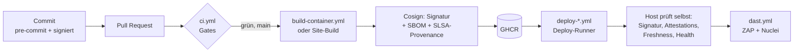

# security-pipeline

Zentrale, wiederverwendbare DevSecOps-Pipeline für alle Repos der Organisation
**Pascal-Organisation**. Jedes Projekt ruft diese Workflows mit ein paar Zeilen auf –
Sicherheits-Gates, Tool-Versionen und Policies werden hier einmal gepflegt und gelten
überall.

> Status: **v0.3.1** – in allen 10 Repos der Org als PR (Branch `security-pipeline`)
> vorbereitet, gemergt und live bisher nur in `pascalhaag-website`. Wer was nutzt und
> was fehlt: [Umsetzung in den Repos](#umsetzung-in-den-repos).

---

## Überblick



Zwei Achsen bestimmen, was ein Repo bekommt:

| | **öffentlich** | **privat** |
|---|---|---|
| Runner | GitHub-hosted (erzwungen) | eigene Self-hosted Runner (Proxmox) |
| SAST | CodeQL | Semgrep (+ Bandit für Python) |
| Signatur | Cosign keyless (Sigstore, OIDC) | Cosign Key-Pair, **kein** Eintrag im öffentlichen Rekor-Log |
| Schutz von `main` | Rulesets / Branch Protection | Deploy nur aus `main`; Host prüft Signatur & Herkunft |
| Deploy | Pull: Host-Timer holt `:latest`, prüft, startet | Push: Deploy-Runner bittet Host per SSH-Forced-Command |

| | **Container** | **Statisch** |
|---|---|---|
| Build | `build-container.yml` | eigener Build-Job im Projekt (z. B. Hugo), Artefakt `site.tgz` |
| Deploy | `deploy-container.yml` → `app-deploy` auf dem Host | `deploy-static.yml` (SSH-Receive oder FTPS) |

**Die Sichtbarkeit wird nie aus einem Input gelesen**, sondern aus
`github.event.repository.private`. Ein öffentliches Repo läuft dadurch *immer* auf
GitHub-hosted Runnern – egal, was der Aufrufer übergibt. Fork-PRs können die Runner
auf dem Proxmox-Host nie erreichen.

---

## Die Workflows

### `ci.yml` – Gate für jeden PR und Push

| Schritt | Tool | Was es tut | Gate |
|---|---|---|---|
| Workflow-Lint | **actionlint** | Syntax, Typen, Expressions, Shellcheck in `run:` | jeder Fehler |
| Workflow-Security | **zizmor** | Template-Injection, gefährliche Trigger, zu breite Permissions, ungepinnte Actions | ≥ medium |
| Secrets | **TruffleHog** | sucht Secrets im Diff (PR/Push) bzw. der ganzen Historie (Schedule) und prüft, ob sie noch gültig sind | verified + unknown |
| SAST öffentlich | **CodeQL** | Datenfluss-Analyse (`security-extended`), Ergebnisse im Security-Tab | – (Alerts) |
| SAST privat | **Semgrep CE** | Regel-basiert, `p/default` | Severity ERROR |
| SAST Python privat | **Bandit** | Python-spezifisch (subprocess, pickle, yaml.load, …) | high / confidence ≥ medium |
| Dependencies + IaC | **Trivy fs** | CVEs in Lockfiles, Fehlkonfigurationen (Dockerfile, Terraform, …), Lizenzen | fixable HIGH/CRITICAL |
| Dockerfile | **hadolint** | Best Practices für Dockerfiles | error |

### `build-container.yml` – Release eines Images (nur `main`)

1. `docker build` mit OCI-Labels (`created` ist Pflicht: Replay-Schutz auf dem Host)
2. **Trivy image** – Gate: fixable HIGH/CRITICAL + eingebettete Secrets
3. **Syft** – SBOM im **CycloneDX**-Format
4. Push nach `ghcr.io/pascal-organisation/<repo>` – genau das gescannte Tar, kein Rebuild
5. **SLSA-v1-Provenance** – ehrlich eingeordnet: Build **L1 + Signatur**. Das Prädikat
   schreiben Steps im selben, nutzerkontrollierten Job; L2/L3 bräuchte Provenance von der
   Build-Plattform selbst. `builder.id` enthält die Pipeline-Version.
6. **Cosign**: Signatur + Attestations (SBOM, Provenance), danach Selbst-Verifikation
   - öffentlich: keyless, Identität = dieser Workflow, Repo, `refs/heads/main`
   - privat: Org-Key, `--tlog-upload=false`

Der Build läuft **nur auf `main`** (Guard im Workflow); der Signier-Job prüft das noch
einmal. Für private Repos kann er per `signing-runner` auf einen eigenen Runner, der nie
Builds oder Tests ausführt.

Signieren läuft in einem eigenen Job ohne Scanner; nur der öffentliche Signier-Job darf
ein OIDC-Token erzeugen.

### `deploy-container.yml` – Push-Deploy (privat)

Der Deploy-Runner checkt keinen Code aus. Er schickt nur `deploy sha256:<digest>` per
SSH an den Host. Dort ist der Key in `authorized_keys` auf `app-deploy <app>` und die IP
des Runners festgenagelt. **Der Host entscheidet selbst** (siehe `deployer/app-deploy`):

1. Signatur gültig (keyless-Identität bzw. Org-Public-Key)
2. SBOM-Attestation vorhanden, Provenance-Prädikat nennt **dieses Repo, `refs/heads/main`
   und den Commit aus dem Image-Label** – im Key-Modus bindet erst das die Signatur an
   einen Branch
3. Neuer gebaut als das laufende Image (kein Replay alter, signierter Versionen)
4. optional Backup-Hook → Umschalten → Health-Wait → automatischer Rollback

`rollback` läuft ebenfalls unter Lock mit Health-Wait und setzt einen **Hold**: Der Timer
(Pull-Modus) rollt dann nicht von selbst wieder auf `:latest` vor, bis `unhold` oder ein
expliziter `deploy` kommt. Die `.conf` muss root gehören und darf nicht group/world-writable
sein.

Ein kompromittierter Deploy-Runner kann also höchstens ein Image deployen, das die
Pipeline signiert hat.

### `deploy-static.yml` – statische Seiten (privat)

Prüft das Artefakt (nur Dateien/Ordner, keine Links, keine `..`, `index.html`
`required-file` – Standard `index.html` – liegt im Wurzelverzeichnis), protokolliert seinen SHA-256 und liefert es aus:

- `ssh`: `ssh deploy@host "deploy <sha>" < site.tgz` → Receive-Skript auf dem Ziel
  (z. B. `hugo-receive` auf CT 107: entpacken, atomar umschalten, 5 Releases behalten)
- `ftps`: Datei für Datei per FTPS (Shared Hosting), **nie mit Löschen**

### `dast.yml` – von außen gegen die laufende Seite

- **OWASP ZAP Baseline**: spidert passiv – Header, Cookies, CSP, Info-Leaks
- **Nuclei**: Templates für Fehlkonfigurationen, offene Dateien/Panels, TLS, bekannte CVEs
  (rate-limited, ohne intrusive/fuzz-Templates)

Gate: ZAP High bzw. Nuclei high/critical. Ein Scan, der nicht läuft (ZAP-Exit ≥ 3, Nuclei
ohne geladene Templates), ist **kein** Pass. Templates sind auf ein Release gepinnt
(Renovate hält es aktuell). DAST läuft immer auf GitHub-hosted Runnern – die Ziele sind
öffentlich, und die CI-VM braucht so keinen Egress zu beliebigen Seiten. Mit Staging (z. B. websiteghana
`/release-test`) **vor** dem Produktiv-Deploy, sonst direkt danach gegen live.

### `image-rescan.yml` – wöchentlicher Re-Scan

Scannt `ghcr.io/<repo>:latest` mit frischen CVE-Daten (per `schedule:` aufrufen). Überbrückt
die Zeit bis Dependency-Track: neue fixable HIGH/CRITICAL in bereits ausgerollten Images
werden sichtbar.

Bekannte Grenzen: Der Re-Scan checkt kein Repo aus, Ausnahmen aus `.trivyignore.yaml`
gelten hier also nicht. Und er scannt `:latest`, nicht zwingend den Digest, der auf dem
Host läuft (nach einem Rollback sind das zwei verschiedene Images). Noch ruft ihn kein Repo auf.

### Deploy-Status

Jeder Deploy legt ein **GitHub Deployment** an (`in_progress` → `success`/`failure`,
mit Digest bzw. Artefakt-Hash), schreibt eine Job-Summary und schickt optional eine
**ntfy**-Push-Nachricht (Secret `NTFY_URL`).

---

## Nutzung

Aufrufer pinnen die Workflows **per Commit-SHA** (mit Versions-Kommentar), Renovate hält
sie aktuell:

```yaml
jobs:
  security:
    uses: Pascal-Organisation/security-pipeline/.github/workflows/ci.yml@<sha> # v0.3.1
    permissions:          # Obergrenze für die verschachtelten Jobs
      contents: read
      actions: read         # nur CodeQL (öffentlich) nutzt das
      security-events: write
    with:
      private-runner: '["self-hosted","ci"]'
      python-paths: "src"
      dockerfile: Dockerfile
```

GitHub prüft die `permissions` des Aufrufers gegen **jeden** verschachtelten Job –
auch gegen Jobs, die übersprungen werden (CodeQL, keyless Signing in privaten Repos).
Der Aufrufer gibt deshalb eine Obergrenze an; jeder Job hier deklariert selbst nur das,
was er braucht. Für `build-container.yml` heißt das: `contents: read`,
`packages: write`, `id-token: write`.

Vollständige Beispiele:

- öffentlich + Container: [`solar`](https://github.com/Pascal-Organisation/solar) – `.github/workflows/release.yml`
- privat + Container: `tickets` – `.github/workflows/ci.yml`, `release.yml`
- privat + statisch per SSH: `pascalhaag-website` – `.github/workflows/deploy.yml`
- privat + statisch per FTPS mit Staging: `websiteghana` – `.github/workflows/release.yml`

## Umsetzung in den Repos

Stand 30.10.2026. „Branch“ heißt: Umstellung liegt als PR auf dem Branch
`security-pipeline` und gilt erst nach dem Merge.

| Repo | Sichtbarkeit | Typ | Nutzt | Pin | Stand |
|---|---|---|---|---|---|
| `pascalhaag-website` | privat | statisch, SSH | `ci`, `deploy-static`, `dast` | v0.3.0 | **gemergt, live** – Pin auf v0.3.1 heben (Nuclei-Fix) |
| `websiteghana` | privat | statisch, FTPS + Staging | `ci`, `deploy-static`, `dast` | v0.3.1 | Branch |
| `tickets` | privat | Container, Push-Deploy | `ci`, `build-container` (Key), `deploy-container` | v0.3.0 | Branch |
| `solar` | öffentlich | Container, Pull-Deploy | `ci`, `build-container` (keyless) | v0.3.0 | Branch – Merge erst mit Umstellung des Hosts auf `app-deploy` |
| `bahnbot` | privat | Container, Pull-Deploy | nur `ci` | v0.3.0 | Branch – **Abweichung**, siehe unten |
| `homelab` | privat | nur CI | `ci` | v0.3.0 | Branch |
| `knowledgebase` | privat | nur CI | `ci` | v0.3.0 | Branch |
| `workingrepo` | privat | nur CI, inaktiv | `ci` | v0.3.0 | Branch |
| `anmeldungunihandball` | öffentlich | nur CI | `ci` | v0.3.0 | Branch |
| `Poose3` | öffentlich | nur CI, nicht gepflegt | `ci` | v0.3.0 | Branch – Trivy rot (alte Abhängigkeiten) |

Noch von keinem Repo genutzt: `image-rescan.yml`, `signing-runner`, das
pre-commit-Template (nur `bahnbot` hat eine eigene `.pre-commit-config.yaml`).

**Abweichung `bahnbot`:** baut, signiert und deployt mit einer eigenen `release.yml` und
einem eigenen Deployer statt `build-container.yml` und `app-deploy`. Unterschiede zum
Standard: Signatur keyless, obwohl das Repo privat ist (Repo- und Workflow-Name landen im
öffentlichen Rekor-Log), SBOM als SPDX statt CycloneDX, älteres Trivy, Trivy-Cache als
Named Volume. Dafür hat es einen **Release-Policy-Job**, den die zentrale Pipeline noch
nicht hat: Gebaut wird nur ein von GitHub verifizierter Commit, der selbst der Merge eines
PRs nach `main` ist.

### Secrets (Org-Ebene, auf ausgewählte Repos beschränkt)

| Secret | Wofür |
|---|---|
| `COSIGN_PRIVATE_KEY`, `COSIGN_PASSWORD` | Signieren privater Images (`cosign generate-key-pair`) |
| `DEPLOY_SSH_KEY`, `DEPLOY_KNOWN_HOSTS` | pro Repo: Key, der auf dem Ziel nur das Receive-/Deploy-Skript darf |
| `NTFY_URL` | optional: Deploy-Benachrichtigung |

Der Public Key (`cosign.pub`) liegt auf jedem Host unter `/etc/app-deploy/cosign.pub`.

---

## Runner

| Rolle | Labels in den Workflows | genutzt von | Netz |
|---|---|---|---|
| CI (VM 110) | `ci` | `homelab`, `knowledgebase`, `workingrepo`, `tickets` | ausgehend nur GitHub, Registries, Paketquellen, semgrep.dev |
| CI, eigener Runner pro Repo | `pascalhaag-website`, `websiteghana`, `bahnbot` | das jeweilige Repo | wie `ci` |
| Deploy (VM 111) | `pascalhaag-website-deploy`, `websiteghana-deploy`, `tickets-deploy` | nur Deploy-Jobs des jeweiligen Repos | nur zu den Zielhosts (+ GitHub) |
| GitHub-hosted | `ubuntu-24.04` | alle **öffentlichen** Repos, DAST und Re-Scan auch für private | – |

Regeln: CI- und Deploy-Runner auf getrennten VMs, beide per Proxmox-Firewall vom LAN
getrennt; Self-hosted Runner nie für öffentliche Repos freigeben. Der Signier-Job von
`tickets` läuft derzeit auf `ci`, also auf derselben VM wie Builds und Tests (siehe Grenzen).

**Grenzen, offen benannt:**
- Die Runner sind **persistent**, nicht pro Job neu (Stand laut homelab- und
  websiteghana-Doku). Arbeitsverzeichnis, Docker-Daemon, Images und Build-Cache bleiben
  zwischen Jobs und Repos bestehen; Zugriff auf den Docker-Socket ist faktisch root auf der
  VM. Gegenmaßnahmen hier: `docker build --pull`, Trivy-Cache pro Run, Scanner als
  Runner-User, `persist-credentials: false`. Sauber wird es erst mit einer frischen VM pro
  Job (Proxmox-Template klonen).
- Der Cosign-Key privater Repos ist ein GitHub-Secret und damit für jeden Workflow der
  freigegebenen Repos lesbar. Der Branch-Guard und die Provenance-Prüfung auf dem Host
  schließen „Feature-Branch signiert“, aber nicht „jemand mit Schreibrechten liest den Key
  aus“. Ziel: eigener Signier-Runner mit lokalem Key statt Secret.
- TruffleHog kann ohne Egress zu den Providern nichts verifizieren – Funde sind dann
  `unknown` und blockieren (gewollt, aber laut).
- zizmor und Bandit werden per pip **ohne Hashes** installiert (Version gepinnt). Das
  digest-gepinnte zizmor-OCI-Image braucht x86-64-v2. Die VMs 110/111 laufen laut
  websiteghana-Doku seit 05.10. mit CPU-Typ `host` – das Image sollte dort also laufen;
  Umstellung steht noch aus.

## Host-Setup (Container-Apps)

```bash
install -m 0755 deployer/app-deploy /usr/local/sbin/app-deploy
install -d -m 0755 /etc/app-deploy
install -m 0644 deployer/app.conf.example /etc/app-deploy/<app>.conf   # anpassen
install -m 0644 cosign.pub /etc/app-deploy/cosign.pub                   # nur private Repos
```

- **privat (push):** `authorized_keys` des Users `deploy`:
  `restrict,from="<IP VM 111>",command="/usr/local/sbin/app-deploy <app>" ssh-ed25519 AAAA…`
- **öffentlich (pull):** systemd-Timer ruft `/usr/local/sbin/app-deploy <app>` auf.
- Voraussetzungen: `cosign` ≥ v3, Docker Compose v2, `flock`.
- Kommandos über SSH: `deploy sha256:<digest>`, `status`, `rollback`, `unhold`.
- Pull-Apps (kein SSH-Zugang von außen) lokal auf dem Host:
  `SSH_ORIGINAL_COMMAND=rollback /usr/local/sbin/app-deploy <app>` bzw. `…=unhold …`.

## Ausnahmen

Akzeptierte Findings gehören in `.trivyignore.yaml` im jeweiligen Repo – immer mit
Begründung und `expired_at`. Eine Ausnahme ohne Ablaufdatum wird nie wieder angesehen.

## Lokal: pre-commit & signierte Commits

`templates/pre-commit-config.yaml` → als `.pre-commit-config.yaml` ins Repo
(gitleaks, actionlint, zizmor, hadolint, Basis-Checks).

```bash
git config --global gpg.format ssh
git config --global user.signingkey ~/.ssh/id_ed25519.pub
git config --global commit.gpgsign true
```

## Renovate

`renovate/default.json` ist das gemeinsame Preset: pinnt Actions und Images auf
Digests, aktualisiert auch `image:tag@sha256` in `run:`-Zeilen und Skripten (was
Dependabot nicht kann), regeneriert gehashte pip-compile-Locks (wöchentlich), wartet 3 Tage nach einem Release und
merged kleine Updates selbst als PR, sobald alle Checks grün sind. Ausgenommen: Majors,
die eigenen Workflows aus diesem Repo und Minor-/Major-Sprünge von Laufzeit-Images
(python, php, node, …) – die kommen immer als PR zur Durchsicht. Pro Repo:

```json
{ "extends": ["local>Pascal-Organisation/security-pipeline//renovate/default"] }
```

## Roadmap

- **Dependency-Track** (self-hosted): SBOMs aller Releases, Alarm bei neuen CVEs in
  bereits deployten Versionen
- **Harbor** statt GHCR: Registry-seitig unsignierte Images ablehnen
- Org-Rulesets für öffentliche Repos (signierte Commits, required checks)
- **Statische Deploys absichern (vorgezogen):** Signatur fürs Artefakt (`cosign sign-blob`)
  und Prüfung im Receive-Skript; bei FTPS verwaiste Dateien melden (bisher bleibt eine
  versehentlich veröffentlichte Datei dauerhaft live, weil nie gelöscht wird)
- **CodeQL als Gate** in öffentlichen Repos: Code-Scanning-Merge-Protection per Ruleset
  (kostenlos für öffentliche Repos)
- **Signierte Commits in privaten Repos prüfen:** CI-Check per `git verify-commit` gegen
  eine `allowed_signers`-Datei (Rulesets kosten bei privaten Repos)
