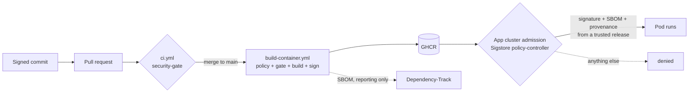

# security-pipeline

The central, reusable DevSecOps pipeline for every repository in the **Pascal-Organisation** GitHub
organisation. Each project calls these workflows with a few lines of YAML. Security gates, tool versions
and policies are maintained here once and apply everywhere.

> **In one sentence:** a container image runs in the app cluster only if *this* repository's
> `build-container.yml`, at a known release commit, built it from a merged pull request on `main`, after the
> security gate passed, and signed it together with an SBOM and a provenance statement.

| | |
|---|---|
| Current release | see [`VERSION`](VERSION) |
| Consumers | 8 repositories (`fleet/repos.json`, live state: `tools/fleet-status.sh`) |
| **Why it is built this way** | [docs/decisions.md](docs/decisions.md): every decision with its reason, alternatives and trade-offs |
| Adding a project | [docs/new-project.md](docs/new-project.md) |
| How the self-hosted CI is isolated | [docs/runners.md](docs/runners.md) |
| Swapping a tool, releasing the pipeline | [docs/switching-tools.md](docs/switching-tools.md) |

---

## The idea



**Why it works without branch protection.** GitHub Free cannot stop a merge in a private repository. So the
pipeline does not try to protect the merge. It protects the *release*: `build-container.yml` checks the
release policy and runs the security gate inside itself, and only then signs. The cluster accepts only
signatures whose identity is `build-container.yml@<trusted release SHA>`. A caller can delete a `needs:` line
from its own workflow, but it cannot get this workflow's identity without running these jobs. A valid
signature is therefore proof that policy and gate ran.

### What a signature proves, and what it does not

| Proves | Does not prove |
|---|---|
| The image was built by `build-container.yml` at a release commit of this repo | Who wrote the code (the `main` ruleset and signed commits cover that) |
| It came from `refs/heads/main` of the named repository, and the commit was the merge of a PR | That the code is free of bugs: only that the gates found nothing blocking |
| Trivy scanned exactly these bytes (the pushed digest must equal the scanned digest) | SLSA Build L2/L3: provenance comes from a job step, so we claim **L1 plus signature** |
| An SBOM (CycloneDX) and a SLSA v1 provenance statement belong to it | That the image still has no known CVEs today (Dependency-Track re-checks daily, reporting only) |

---

## Public and private repositories

The pipeline reads the visibility from the GitHub API in its first job (never from an input) and
fails closed if it can't.

| | **Public** | **Private** |
|---|---|---|
| Runner | GitHub-hosted, always. **Rule: public code never runs on our own machines.** | CI cluster: an ARC scale set per trust domain, a fresh pod per job |
| Image build | buildx builder with the same BuildKit release, on GitHub's throwaway VM | rootless BuildKit (`bk`) inside the pod, no Docker daemon |
| SAST | CodeQL | Semgrep (plus Bandit for Python) |
| Signing | Cosign keyless, GitHub-hosted | Cosign keyless, GitHub-hosted (the repo and workflow names appear in the public Rekor log, the code does not) |
| Merge protection | Ruleset: `Security / security-gate` required | Not enforceable on GitHub Free, **but no release without the gate and a merged PR** |

Signing always runs on GitHub-hosted runners, in a job that runs no repository code and no third-party
scanner. That way scanner code never holds the `id-token` permission.

### Project profiles

| Profile | For | Deployment |
|---|---|---|
| `ci-only` | Code without a deployment | none |
| `container-pull` | Everything that runs in the app cluster, including static sites as an nginx image | Cluster admission checks the signature; an in-cluster updater rolls new builds out |
| `static-ftps` | Shared hosting that can't check anything itself | `deploy-static.yml` checks the gate and `main`, then uploads over FTPS |

---

## The workflows

### `ci.yml`: the gate for every PR and push

| Check | Tool | What it does | Blocks on |
|---|---|---|---|
| Workflow lint | **actionlint** | Syntax, types, expressions, shellcheck inside `run:` | any error |
| Workflow security | **zizmor** | Template injection, dangerous triggers, broad permissions, unpinned actions | ≥ medium |
| Secrets | **TruffleHog** | Secrets in the diff (PR/push) or the whole history (schedule), verified against the provider | verified + unknown |
| SAST, public | **CodeQL** | Data-flow analysis (`security-extended`), results in the Security tab | – (alerts) |
| SAST, private | **Semgrep CE** | Rule-based, `p/default` | severity ERROR |
| SAST Python, private | **Bandit** | Python-specific (subprocess, pickle, `yaml.load`, …) | high, confidence ≥ medium |
| Dependencies + IaC | **Trivy fs** | CVEs in lock files, misconfigurations (Dockerfile, Kubernetes, Terraform), licences | fixable HIGH/CRITICAL |
| Dockerfile | **hadolint** | Dockerfile best practices | error |

All jobs report into one check, **`Security / security-gate`**. That check is the only thing callers and
rulesets depend on, so a tool can be swapped here without touching any repo.

### `build-container.yml`: releasing an image (main only)

1. **Release policy:** the commit is on `main`, GitHub-verified (signed), and the merge result of a PR. A
   direct push still lands in git, but it never gets signed.
2. **Gate:** the same `ci.yml` as on the PR.
3. **Build** into an **OCI tar**, with OCI labels. `org.opencontainers.image.created` is mandatory: the
   cluster's updater uses it for replay protection. Private repos build with rootless BuildKit in the CI
   cluster, public repos with a digest-pinned buildx builder on GitHub-hosted runners.
4. **Trivy image** on the tar. It blocks on fixable HIGH/CRITICAL findings and embedded secrets.
5. **Syft** writes a **CycloneDX** SBOM from the same tar. OS packages (`pkg:deb`, `pkg:apk`) lose the
   CPEs Syft guessed. Distributions backport fixes without bumping the upstream version, so a CPE match
   against NVD reports CVEs that are long fixed. Dependency-Track judges them by purl against OSV instead,
   which is the same data the Trivy gate uses.
6. **Push** to `ghcr.io/pascal-organisation/<repo>` with **crane**: exactly the scanned bytes (the tar
   unpacked once as an OCI layout), with no rebuild and no re-tag by a daemon. The job fails if the registry
   digest differs from the manifest digest inside the scanned tar.
7. **SLSA v1 provenance**, described honestly as Build **L1 plus signature**.
8. **Cosign keyless:** signature and attestations (SBOM, provenance) on a GitHub-hosted runner, without
   repository code and without scanners.
9. **Dependency-Track:** the signed SBOM is uploaded as project `<repo>`, version = commit. The upload uses a
   Cloudflare Access service token that opens only `/api/v1/bom`. It is reporting only: if Dependency-Track
   is down, the release stays green. Without the three `DTRACK_*` secrets the step is skipped.

### Deployment: cluster admission instead of a host agent

Since v3 the **cluster** decides what may run. The Sigstore **policy-controller** checks every pod's image
against a `ClusterImagePolicy` per application. The policy demands three things:

- keyless identity `…/security-pipeline/.github/workflows/build-container.yml@<sha>`, with the GitHub OIDC issuer;
- a CycloneDX SBOM attestation;
- a SLSA provenance that names the repository and `refs/heads/main`.

Callers pin the pipeline by commit SHA, so the identity ends in that SHA. The policies list only release
commits of this repository. A branch with a gutted `build-container.yml` produces a valid signature, but as
`@<branch-sha>`, and admission refuses it.

**Every pipeline release therefore follows a fixed order:** signed tag → its SHA into the cluster
policies (and applied) → only then the callers move. `build-container.yml` must not be renamed or moved
without the overlap described in [switching-tools.md](docs/switching-tools.md).

The former host agent `app-deploy`, a pull-based deployer per host, was removed in v3.0.2. The last
release that contains it is v3.0.1.

### `deploy-static.yml`: shared hosting

This workflow is for targets that can't verify anything themselves. Before the upload it checks on its own
that the commit is on `main` and that `Security / security-gate` is green. It inspects the artifact (only
files and folders, no links, no `..`). It then uploads over FTPS and **never deletes**: a deploy that can
delete eventually deletes the wrong thing. It runs GitHub-hosted, because the target is public shared
hosting and a deploy VM in the LAN would only add an FTP egress hole.

### `dast.yml`: testing the running site from outside

- **OWASP ZAP baseline** spiders passively and checks headers, cookies, CSP and information leaks.
- **Nuclei** runs templates for misconfigurations, exposed files and panels, TLS and known CVEs. It is
  rate-limited and uses no intrusive or fuzzing templates.

It blocks on ZAP High or Nuclei high/critical. A scan that does not run (ZAP exit ≥ 3, or Nuclei with no
templates loaded) is **not** a pass. DAST always runs on GitHub-hosted runners: the targets are public
URLs, so the CI cluster needs no egress to arbitrary sites. With staging it runs **before** the production
deploy (for example websiteghana `/release-test`), otherwise right after.

### `image-rescan.yml`: weekly re-scan (being retired)

It re-scans `ghcr.io/<repo>:latest` with fresh CVE data. Dependency-Track replaces it, because it re-checks
every uploaded SBOM daily.

Known limits of the re-scan:
- It does not check out the repository, so `.security/exceptions.json` doesn't apply.
- It scans `:latest`, which is not necessarily the digest running in the cluster.

### What "green" means

Green in GitHub means the release is done and signed. Whether it is *running* is shown by the cluster
(updater logs, monitoring in the app cluster).

---

## Using it

Callers pin the workflows **by commit SHA**, with a version comment. Renovate keeps them current:

```yaml
jobs:
  security:
    name: Security          # required: produces the check "Security / security-gate"
    uses: Pascal-Organisation/security-pipeline/.github/workflows/ci.yml@<sha> # vX.Y.Z
    permissions:            # upper bound for the nested jobs
      contents: read
      actions: read         # only CodeQL (public) uses it
      security-events: write
      packages: read        # pull the private ci-toolbox
    with:
      python-paths: "src"
      dockerfile: Dockerfile
```

GitHub checks the caller's `permissions` against **every** nested job, including jobs that are skipped.
The caller therefore states an upper bound, and each job here declares only what it needs. If the bound is
too low, the run fails as `startup_failure` with no further explanation.

For `build-container.yml` the bound is:
- `contents: read`, `actions: read`, `security-events: write`;
- `pull-requests: read`, `packages: write`, `id-token: write`.

A caller that runs its own `ci.yml` inside the release workflow must also grant `packages: read` to that
job.

**The private toolbox.** The `ci-toolbox` package is private, and that is an owner decision.
- GitHub-hosted jobs log in with the job's `GITHUB_TOKEN`, pull the toolbox, and delete the login right
  away (a throwaway `DOCKER_CONFIG` under `RUNNER_TEMP`).
- **Every public caller** must be listed under *Packages → ci-toolbox → Package settings → Manage Actions
  access* with role **Read**. That list is UI-only, there is no API for it. Without the entry the pull fails
  with `unauthorized`.
- Private repositories run in the CI cluster, which pulls with its own read-only secret.

For Dependency-Track the release job passes the three secrets explicitly. It does not use
`secrets: inherit`, so the pipeline sees only what it needs:

```yaml
    secrets:
      DTRACK_API_KEY: ${{ secrets.DTRACK_API_KEY }}
      DTRACK_ACCESS_CLIENT_ID: ${{ secrets.DTRACK_ACCESS_CLIENT_ID }}
      DTRACK_ACCESS_CLIENT_SECRET: ${{ secrets.DTRACK_ACCESS_CLIENT_SECRET }}
```

Complete examples: `solar` (public), `bahnbot` (private), `websiteghana` (FTPS).

### The contract

Rulesets and release workflows depend on **one** check, `Security / security-gate`. The jobs under it are
named after capabilities (`Secrets`, `SAST (private)`, `Dependencies & IaC`, …), not after tools. Changing
the contract is a major release. Details in [switching-tools.md](docs/switching-tools.md).

### Secrets in callers

`container-pull` repos need none for deployment, because the cluster pulls by itself. They hold only the
optional `DTRACK_*` trio. `static-ftps` repos hold `FTP_HOST`, `FTP_USER` and `FTP_PASS`.

### Exceptions

Accepted findings go into `.security/exceptions.json` in the repository, always with a reason and an
expiry date. After the expiry the finding blocks again. The format is scanner-neutral, see
[switching-tools.md](docs/switching-tools.md#exceptions).

---

## Runners

| Role | Label | Used by | Network |
|---|---|---|---|
| CI cluster | `arc-ci`, `arc-bahnbot`, `arc-pascalhaag-website`, `arc-websiteghana` (one ARC scale set and runner group per trust domain; pod = `ci-toolbox`) | **private** repos: gate and build | outbound only: GitHub, registries, package mirrors, semgrep.dev |
| GitHub-hosted | `ubuntu-24.04` | all **public** repos; for private repos: signing, SBOM upload, DAST, re-scan, FTPS upload | – |

Rules:
- There is no deploy runner. The cluster pulls signed images, and shared hosting gets its upload from a
  GitHub-hosted runner.
- Self-hosted runners are never available to public repositories. The runner groups refuse them, and
  `ci.yml` routes public repos to GitHub by visibility: two independent safeguards.
- Signing never runs in the CI cluster.
- The input `runner` (default `arc-ci`) selects the scale set of a private repo. The old input
  `private-runner` is still accepted, but ignored, so existing callers don't break.

**Limits, stated openly:**
- Each job gets a **fresh pod**: working directory, BuildKit state and Trivy cache are discarded, and base
  images are always pulled from the registry. There is no Docker socket. Rootless BuildKit still needs relaxed
  seccomp/AppArmor profiles. That is weaker than a microVM per job (see
  [runners.md](docs/runners.md)).
- The toolbox image is part of the supply chain. `toolbox.yml` builds, scans and signs it, but with Docker
  on a GitHub-hosted runner, because it can't build itself.
- Without egress to the providers, TruffleHog can't verify secrets. Findings are then `unknown` and block.
  That is intentional, but noisy.
- Semgrep, zizmor and Bandit are installed into the toolbox by pinned version, but **without hashes**.

---

## Locally: pre-commit and signed commits

Copy `templates/pre-commit-config.yaml` into the repository as `.pre-commit-config.yaml`. It runs
gitleaks, actionlint, zizmor, hadolint and basic checks.

```bash
git config --global gpg.format ssh
git config --global user.signingkey ~/.ssh/id_ed25519.pub
git config --global commit.gpgsign true
```

## Renovate

`renovate/default.json` is the shared preset. It:
- pins actions and images to digests, including `image:tag@sha256` inside `run:` lines and scripts, which
  Dependabot can't do;
- regenerates hashed pip-compile locks weekly;
- waits 3 days after a release;
- merges small updates itself once every check is green.

Majors and minor or major jumps of runtime images (python, php, node, …) always come as a PR for review.
The pipeline's own workflows roll out in rings: `workingrepo` and `anmeldungunihandball` immediately, all
others after 3 days, majors always by hand. Per repository:

```json
{ "extends": ["local>Pascal-Organisation/security-pipeline//renovate/default"] }
```

## Roadmap

- **Harbor** instead of GHCR, to reject unsigned images at the registry.
- Org rulesets for public repositories (signed commits, required checks).
- **Securing static deploys:** a signature for the artifact (`cosign sign-blob`), and reporting orphaned
  files on FTPS. Today a file published by mistake stays live, because nothing is ever deleted.
- **CodeQL as a gate** in public repositories, via code-scanning merge protection in a ruleset (free for public repos).
- **Checking signed commits in private repositories:** a CI check with `git verify-commit` against an
  `allowed_signers` file, since rulesets cost money for private repos.
- The sub-ID layout for rootless BuildKit moves from the cluster's ConfigMap into the toolbox image.
