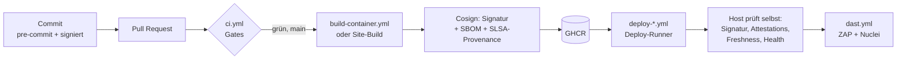

# security-pipeline

Zentrale, wiederverwendbare DevSecOps-Pipeline für alle Repos der Organisation
**Pascal-Organisation**. Jedes Projekt ruft diese Workflows mit ein paar Zeilen auf –
Sicherheits-Gates, Tool-Versionen und Policies werden hier einmal gepflegt und gelten
überall.

> Status: **v0.1.0** – erste Version, läuft in `solar` (öffentlich, Container),
> `tickets` (privat, Container) und `pascalhaag-website` (privat, statisch).

---

## Überblick



Zwei Achsen bestimmen, was ein Repo bekommt:

| | **öffentlich** | **privat** |
|---|---|---|
| Runner | GitHub-hosted (erzwungen) | eigene Self-hosted Runner (Proxmox) |
| SAST | CodeQL | Semgrep (+ Bandit für Python) |
| Signatur | Cosign keyless (Sigstore, OIDC) | Cosign Key-Pair, **kein** Eintrag im öffentlichen Rekor-Log |
| Schutz von `main` | Rulesets / Branch Protection | Deploy nur aus `main`; Host prüft Signatur & Herkunft |
| Deploy | Pull: Host-Timer holt `:latest`, prüft, startet | Push: Deploy-Runner bittet Host per SSH-Forced-Command |

| | **Container** | **Statisch** |
|---|---|---|
| Build | `build-container.yml` | eigener Build-Job im Projekt (z. B. Hugo), Artefakt `site.tgz` |
| Deploy | `deploy-container.yml` → `app-deploy` auf dem Host | `deploy-static.yml` (SSH-Receive oder FTPS) |

**Die Sichtbarkeit wird nie aus einem Input gelesen**, sondern aus
`github.event.repository.private`. Ein öffentliches Repo läuft dadurch *immer* auf
GitHub-hosted Runnern – egal, was der Aufrufer übergibt. Fork-PRs können die Runner
auf dem Proxmox-Host nie erreichen.

---

## Die Workflows

### `ci.yml` – Gate für jeden PR und Push

| Schritt | Tool | Was es tut | Gate |
|---|---|---|---|
| Workflow-Lint | **actionlint** | Syntax, Typen, Expressions, Shellcheck in `run:` | jeder Fehler |
| Workflow-Security | **zizmor** | Template-Injection, gefährliche Trigger, zu breite Permissions, ungepinnte Actions | ≥ medium |
| Secrets | **TruffleHog** | sucht Secrets im Diff (PR/Push) bzw. der ganzen Historie (Schedule) und prüft, ob sie noch gültig sind | verified + unknown |
| SAST öffentlich | **CodeQL** | Datenfluss-Analyse (`security-extended`), Ergebnisse im Security-Tab | – (Alerts) |
| SAST privat | **Semgrep CE** | Regel-basiert, `p/default` | Severity ERROR |
| SAST Python privat | **Bandit** | Python-spezifisch (subprocess, pickle, yaml.load, …) | high / confidence ≥ medium |
| Dependencies + IaC | **Trivy fs** | CVEs in Lockfiles, Fehlkonfigurationen (Dockerfile, Terraform, …), Lizenzen | fixable HIGH/CRITICAL |
| Dockerfile | **hadolint** | Best Practices für Dockerfiles | error |

### `build-container.yml` – Release eines Images (nur `main`)

1. `docker build` mit OCI-Labels (`created` ist Pflicht: Replay-Schutz auf dem Host)
2. **Trivy image** – Gate: fixable HIGH/CRITICAL + eingebettete Secrets
3. **Syft** – SBOM im **CycloneDX**-Format
4. Push nach `ghcr.io/pascal-organisation/<repo>` – genau das gescannte Tar, kein Rebuild
5. **SLSA-v1-Provenance** (Build L2)
6. **Cosign**: Signatur + Attestations (SBOM, Provenance), danach Selbst-Verifikation
   - öffentlich: keyless, Identität = dieser Workflow, Repo, `refs/heads/main`
   - privat: Org-Key, `--tlog-upload=false`

Signieren läuft in einem eigenen Job ohne Scanner; nur der öffentliche Signier-Job darf
ein OIDC-Token erzeugen.

### `deploy-container.yml` – Push-Deploy (privat)

Der Deploy-Runner checkt keinen Code aus. Er schickt nur `deploy sha256:<digest>` per
SSH an den Host. Dort ist der Key in `authorized_keys` auf `app-deploy <app>` und die IP
des Runners festgenagelt. **Der Host entscheidet selbst** (siehe `deployer/app-deploy`):

1. Signatur gültig (keyless-Identität bzw. Org-Public-Key)
2. SBOM- **und** Provenance-Attestation vorhanden → Image kam durch die Pipeline
3. Neuer gebaut als das laufende Image (kein Replay alter, signierter Versionen)
4. optional Backup-Hook → Umschalten → Health-Wait → automatischer Rollback

Ein kompromittierter Deploy-Runner kann also höchstens ein Image deployen, das die
Pipeline signiert hat.

### `deploy-static.yml` – statische Seiten (privat)

Prüft das Artefakt (nur Dateien/Ordner, keine Links, keine `..`, `index.html`
vorhanden), protokolliert seinen SHA-256 und liefert es aus:

- `ssh`: `ssh deploy@host "deploy <sha>" < site.tgz` → Receive-Skript auf dem Ziel
  (z. B. `hugo-receive` auf CT 107: entpacken, atomar umschalten, 5 Releases behalten)
- `ftps`: Datei für Datei per FTPS (Shared Hosting), **nie mit Löschen**

### `dast.yml` – von außen gegen die laufende Seite

- **OWASP ZAP Baseline**: spidert passiv – Header, Cookies, CSP, Info-Leaks
- **Nuclei**: Templates für Fehlkonfigurationen, offene Dateien/Panels, TLS, bekannte CVEs
  (rate-limited, ohne intrusive/fuzz-Templates)

Gate: ZAP High bzw. Nuclei high/critical. Mit Staging (z. B. websiteghana
`/release-test`) **vor** dem Produktiv-Deploy, sonst direkt danach gegen live.

### Deploy-Status

Jeder Deploy legt ein **GitHub Deployment** an (`in_progress` → `success`/`failure`,
mit Digest bzw. Artefakt-Hash), schreibt eine Job-Summary und schickt optional eine
**ntfy**-Push-Nachricht (Secret `NTFY_URL`).

---

## Nutzung

Aufrufer pinnen die Workflows **per Commit-SHA** (mit Versions-Kommentar), Renovate hält
sie aktuell:

```yaml
jobs:
  security:
    uses: Pascal-Organisation/security-pipeline/.github/workflows/ci.yml@<sha> # v0.1.0
    permissions:          # Obergrenze für die verschachtelten Jobs
      contents: read
      actions: read         # nur CodeQL (öffentlich) nutzt das
      security-events: write
    with:
      private-runner: '["self-hosted","ci"]'
      python-paths: "src"
      dockerfile: Dockerfile
```

GitHub prüft die `permissions` des Aufrufers gegen **jeden** verschachtelten Job –
auch gegen Jobs, die übersprungen werden (CodeQL, keyless Signing in privaten Repos).
Der Aufrufer gibt deshalb eine Obergrenze an; jeder Job hier deklariert selbst nur das,
was er braucht. Für `build-container.yml` heißt das: `contents: read`,
`packages: write`, `id-token: write`.

Vollständige Beispiele:

- öffentlich + Container: [`solar`](https://github.com/Pascal-Organisation/solar) – `.github/workflows/release.yml`
- privat + Container: `tickets` – `.github/workflows/ci.yml`, `release.yml`
- privat + statisch: `pascalhaag-website` – `.github/workflows/deploy.yml`

### Secrets (Org-Ebene, auf ausgewählte Repos beschränkt)

| Secret | Wofür |
|---|---|
| `COSIGN_PRIVATE_KEY`, `COSIGN_PASSWORD` | Signieren privater Images (`cosign generate-key-pair`) |
| `DEPLOY_SSH_KEY`, `DEPLOY_KNOWN_HOSTS` | pro Repo: Key, der auf dem Ziel nur das Receive-/Deploy-Skript darf |
| `NTFY_URL` | optional: Deploy-Benachrichtigung |

Der Public Key (`cosign.pub`) liegt auf jedem Host unter `/etc/app-deploy/cosign.pub`.

---

## Runner

| Runner-Gruppe | VM | darf | Netz |
|---|---|---|---|
| `ci` | VM 110 | alle **privaten** Repos | ausgehend nur GitHub, Registries, Paketquellen, semgrep.dev |
| `deploy` | VM 111 | nur ausgewählte private Repos, nur Deploy-Jobs | nur zu den Zielhosts (+ GitHub) |
| – | GitHub-hosted | alle **öffentlichen** Repos | – |

Regeln: Runner ephemeral (`--ephemeral`, frische Umgebung pro Job), eigenes VLAN ohne
Route ins Management-Netz, Self-hosted Runner nie für öffentliche Repos freigeben.

## Host-Setup (Container-Apps)

```bash
install -m 0755 deployer/app-deploy /usr/local/sbin/app-deploy
install -d -m 0755 /etc/app-deploy
install -m 0644 deployer/app.conf.example /etc/app-deploy/<app>.conf   # anpassen
install -m 0644 cosign.pub /etc/app-deploy/cosign.pub                   # nur private Repos
```

- **privat (push):** `authorized_keys` des Users `deploy`:
  `restrict,from="<IP VM 111>",command="/usr/local/sbin/app-deploy <app>" ssh-ed25519 AAAA…`
- **öffentlich (pull):** systemd-Timer ruft `/usr/local/sbin/app-deploy <app>` auf.
- Voraussetzungen: `cosign` ≥ v3, Docker Compose v2, `flock`.
- Kommandos über SSH: `deploy sha256:<digest>`, `status`, `rollback`.

## Ausnahmen

Akzeptierte Findings gehören in `.trivyignore.yaml` im jeweiligen Repo – immer mit
Begründung und `expired_at`. Eine Ausnahme ohne Ablaufdatum wird nie wieder angesehen.

## Lokal: pre-commit & signierte Commits

`templates/pre-commit-config.yaml` → als `.pre-commit-config.yaml` ins Repo
(gitleaks, actionlint, zizmor, hadolint, Basis-Checks).

```bash
git config --global gpg.format ssh
git config --global user.signingkey ~/.ssh/id_ed25519.pub
git config --global commit.gpgsign true
```

## Renovate

`renovate/default.json` ist das gemeinsame Preset: pinnt Actions und Images auf
Digests, aktualisiert auch `image:tag@sha256` in `run:`-Zeilen und Skripten (was
Dependabot nicht kann), wartet 3 Tage nach einem Release und merged kleine Updates selbst,
sobald alle Checks grün sind. Pro Repo:

```json
{ "extends": ["local>Pascal-Organisation/security-pipeline//renovate/default"] }
```

## Roadmap

- **Dependency-Track** (self-hosted): SBOMs aller Releases, Alarm bei neuen CVEs in
  bereits deployten Versionen
- **Harbor** statt GHCR: Registry-seitig unsignierte Images ablehnen
- Org-Rulesets für öffentliche Repos (signierte Commits, required checks)
- Signatur auch für statische Artefakte (`cosign sign-blob`, Prüfung im Receive-Skript)
