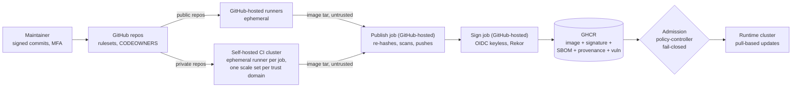

# Target architecture (architectural goal)

Status: **binding goal**, adopted 2026-11-09 (decision D-40). Owner: @pascal05.
Companion: the infrastructure goal lives in the operator's private infrastructure repository (goal IDs `H-*`).

This document defines the state the Pascal-Organisation software supply chain is built towards. It is the yardstick
for every change: a PR that moves away from a goal below needs a recorded decision (`docs/decisions.md`) that names
the goal ID and the reason. Current state lives in the README and `docs/*.md`; the path from today to this goal is
the private roadmap (task IDs like `2.2` are referenced below).

Constraints that shape every goal: **zero cost** (GitHub Free organisation, free/open-source tooling, own hardware),
**one maintainer**, **security as strict as these constraints allow**.

## 1. Principles

These principles are canonical here; the infrastructure goal inherits them.

| ID | Principle | Consequence |
|---|---|---|
| P1 | **Fail closed** | A missing signature, attestation, check result or policy match blocks; there is no "warn and continue" for trust decisions. |
| P2 | **Everything that runs is signed or pinned** | Own images: keyless signature from this pipeline. Third-party images and actions: immutable digest/SHA pinned in git. |
| P3 | **Trust is an identity, not a location** | Consumers trust "built by `build-container.yml` of this repo, from `main`, via GitHub OIDC" — never a registry, tag or network. |
| P4 | **Separate trust domains** | Public code never executes on own hardware; private repos build on ephemeral runners per trust domain; CI and runtime never share a cluster. |
| P5 | **Least privilege by default** | `permissions: {}` per workflow, scoped per job; tokens short-lived (OIDC) wherever possible; no long-lived cloud keys. |
| P6 | **Git is the source of truth** | Policies, pins, manifests and settings expectations are in git and reviewed; live state is checked for drift against git. |
| P7 | **Evidence over assertion** | Every release carries machine-verifiable evidence (signature, SBOM, provenance, vulnerability scan) bound to the image digest. |
| P8 | **One place for tools and policy** | Scanners, thresholds and exceptions live in this repo; callers pin a release commit and add nothing of their own. |
| P9 | **Exceptions expire** | Every exception has an owner, a reason and an expiry date; expired exceptions are reported. |
| P10 | **Free and reproducible over clever** | Prefer built-in platform features and open-source tools; document every manual step; automate what repeats. |

## 2. Trust domains

| Domain | Runs | May hold | Must never |
|---|---|---|---|
| Public CI | Public repos on GitHub-hosted runners | `GITHUB_TOKEN` (read), OIDC for signing | Run on own hardware; access private packages beyond read |
| Private CI | Private repos on ephemeral self-hosted runners, one scale set per trust domain | Read token for the private toolbox image | Reach the LAN, the cluster API or another domain's cache |
| Publish | Separate GitHub-hosted job (D-43) | Registry write token (`GITHUB_TOKEN`, `packages: write`) | Execute repository code or Dockerfiles; run on own hardware; trust a digest or tag reported by the build job |
| Signing | Separate GitHub-hosted job | OIDC token for Fulcio | Execute repository code or Dockerfiles |
| Registry | GHCR | Images and referrers (signature, attestations) | Be trusted by itself (P3) |
| Runtime | Consumers (app cluster) | Pull credentials (read-only) | Accept anything that fails the deploy contract (§4.5) |

## 3. How to read the goal tables

Status: **Done** (in a release or live), **Merged** (on `main`, ships with the next release), **Partial**,
**Planned** (task in the hardening plan), **Accepted risk** (deliberately not done, see §6).
"Verify" names the evidence that proves the goal, so it can be re-checked at any time.

## 4. Goal states

### 4.1 Source and repository governance

| ID | Goal | Verify | Status |
|---|---|---|---|
| G-S1 | Default branch of every public repo protected by a ruleset: PR required, no force-push/deletion, required check `security-gate`, strict (up-to-date) checks, dismiss stale approvals, conversations resolved, signed commits | `gh api repos/<r>/rulesets/<id>`; `fleet-drift.yml` | Done (approvals = 0, single maintainer → §6) |
| G-S2 | `CODEOWNERS` in every repo covering `.github/`, `toolbox/`, `renovate/`, admission policies | file present | Done (all repos) |
| G-S3 | Release tags `v*` are signed and immutable (tag ruleset, immutable releases) | `git tag -v vX.Y.Z`; release settings | Partial (immutable releases: owner setting) |
| G-S4 | Org allows only GitHub-owned actions, `Pascal-Organisation/*` and an explicit list; every `uses:` pinned to a full SHA (org-enforced) | `gh api orgs/<org>/actions/permissions` | Done |
| G-S5 | Fork PRs from any external contributor need approval before CI runs | repo Actions settings | Done |
| G-S6 | Secret scanning: push protection on public repos; TruffleHog on every push/PR and full history weekly on all repos | settings + `ci.yml` | Done |
| G-S7 | Coordinated disclosure: `SECURITY.md`, private vulnerability reporting | repo settings | Done |
| G-S8 | Weekly drift check of org/repo security settings against `fleet/repos.json`, alert on drift | `fleet-drift.yml` run history | Partial (workflow live; needs `FLEET_DRIFT_TOKEN`) |
| G-S9 | Organisation requires 2FA for all members | org settings | Done |

### 4.2 CI execution

| ID | Goal | Verify | Status |
|---|---|---|---|
| G-C1 | Public repos build only on GitHub-hosted runners; `ci.yml` refuses self-hosted for public repos (fail closed) | `ci.yml` visibility gate; runner group settings | Done |
| G-C2 | Private repos build on **ephemeral, single-job** runners; one scale set and namespace per trust domain | ARC config, runner group repo lists | Partial (one shared namespace → task 3.2) |
| G-C3 | Runner pods: no Docker daemon, no privileged mode, no host mounts, user namespaces; daemonless rootless builds | runner pod spec | Done (seccomp/AppArmor unconfined for rootless BuildKit → §6, task 3.6) |
| G-C4 | Runner network: default-deny; egress only DNS + public 443/80; no LAN, no cluster API, no metadata | NetworkPolicy + probe matrix | Done (probe matrix OK 2026-11-09) |
| G-C5 | Every workflow starts with `permissions: {}`; jobs request the minimum; org default token read-only; Actions cannot approve PRs | zizmor, org settings | Done |
| G-C6 | No `pull_request_target`/`workflow_run` with untrusted checkout; `persist-credentials: false`; `timeout-minutes` everywhere; no expression injection | zizmor (offline + online) | Done |
| G-C7 | No caches shared across runs or trust domains; fresh BuildKit state per build | workflow review | Done |

### 4.3 Build and gates

| ID | Goal | Verify | Status |
|---|---|---|---|
| G-B1 | One required check per repo (`security-gate`) aggregating: workflow lint + security (zizmor online on public), secrets, SAST (CodeQL public / Semgrep + Bandit private), Trivy vuln + misconfig, hadolint | `ci.yml` | Done (v3.1.0) |
| G-B2 | Gate threshold: fixable HIGH/CRITICAL blocks; unfixable reported; licence deny-list (AGPL/GPL-3/SSPL) blocks | job summaries | Done (v3.2.0, D-42) |
| G-B3 | Public PRs: dependency review blocks new high-severity vulnerable dependencies | `ci.yml` | Done (v3.1.0) |
| G-B4 | Inputs pinned: lockfiles with hashes, base images by digest (Renovate-managed), OS security updates applied at build | Dockerfiles, Renovate | Partial (per repo) |
| G-B5 | Renovate: 7-day cooldown for ordinary updates, 0 days for security fixes, grouped digest bumps for image + policy, registry prefix preserved | `renovate/default.json` | Done (prefix kept since #41) |

### 4.4 Artifacts and evidence

| ID | Goal | Verify | Status |
|---|---|---|---|
| G-A1 | Every image signed keyless by digest in a separate GitHub-hosted sign job; logged in Rekor | `cosign verify` | Done |
| G-A2 | CycloneDX SBOM of the exact scanned image, attested | `cosign verify-attestation --type cyclonedx` | Done |
| G-A3 | SLSA v1 provenance generated by the sign job from OIDC claims + digest (not by the build job); GitHub artifact attestations for public repos with v4.0.0 | `docs/provenance.md` | Done (v3.1.0; GitHub attestations: v4.0.0) |
| G-A4 | Vulnerability scan result attested (`cosign-vuln`) for every release | `cosign verify-attestation --type vuln` | Done (v3.1.0) |
| G-A5 | SBOMs continuously re-evaluated (Dependency-Track), EPSS visible | DT project per image | Done (reporting only) |
| G-A6 | **SLSA Build L3**: provenance from an isolated generator the build cannot influence | — | Planned (stretch, L3) |
| G-A7 | Reproducible image builds (`SOURCE_DATE_EPOCH`, pinned inputs) | rebuild + diff | Planned (stretch, L3) |

### 4.5 Deploy contract (what every consumer must verify)

A runtime may run an own image only if **all** of the following hold; otherwise it must refuse (P1):

1. Signature: keyless, issuer `https://token.actions.githubusercontent.com`, subject
   `https://github.com/Pascal-Organisation/security-pipeline/.github/workflows/build-container.yml@<40-hex SHA>`.
2. Provenance attestation: `externalParameters.workflow.repository` = the consuming app's repo,
   `ref` = `refs/heads/main`; from v3.1.0 also `builder.id` = the reusable workflow at a pinned SHA and event `push`.
3. SBOM attestation present (CycloneDX).
4. From v3.1.0 + policy rollout: vulnerability attestation present.
5. Third-party images: exact digest listed in git; nothing else.
6. Images referenced by digest; tags are informational only.

| ID | Goal | Verify | Status |
|---|---|---|---|
| G-D1 | Contract items 1–3, 5, 6 enforced at admission, fail-closed, no-match = deny | ClusterImagePolicies | Done |
| G-D2 | Contract items 2 (builder.id, event) and 4 enforced | ClusterImagePolicies | Done (enforced on the app cluster 2026-11-09) |
| G-D3 | Deploys are pull-based (the runtime fetches newer signed builds); CI never holds runtime credentials | updater design | Done |
| G-D4 | Desired state of runtime manifests reconciled from git (GitOps) | — | Planned (stretch, L3) |

### 4.6 Vulnerability and exception management

| ID | Goal | Verify | Status |
|---|---|---|---|
| G-V1 | Remediation SLAs: Critical 7 d, High 30 d, Medium 90 d | `docs/decisions.md` | Done |
| G-V2 | Exceptions only in `.security/exceptions.json` with `id`, `kind`, `reason`, `owner`, `expires`; expired ones reported | `ci.yml` | Done (v3.1.0; owner warns, required in v4.0.0) |
| G-V3 | Not-affected findings recorded as OpenVEX, applied to all scans | `.security/vex.openvex.json` | Done (v3.1.0) |
| G-V4 | Running images re-scanned weekly, not only at build | in-cluster job | Planned (task 6.3) |

### 4.7 Release and operations of the pipeline itself

| ID | Goal | Verify | Status |
|---|---|---|---|
| G-R1 | Release order: merge → signed tag → (policy change if needed) → caller pin bumps; consumers match any SHA of `build-container.yml` so releases need no policy edit | `docs/release.md` | Done |
| G-R2 | Toolbox image private, digest-pinned, rebuilt and signed by `toolbox.yml` | GHCR | Done |
| G-R3 | OpenSSF Scorecard weekly, results public | `scorecard.yml` | Done |
| G-R4 | All org settings that matter for security are declared in `fleet/repos.json` | `fleet-drift.yml` | Done |

## 5. Invariants (never)

- Never run public-repo code on own hardware.
- Never sign, attest or push from a job that executes repository code with the signing identity.
- Never trust a tag, a registry or a network location instead of the signer identity.
- Never pin an action or image by a mutable tag.
- Never add a scanner, threshold or exception in a caller repository.
- Never store a long-lived credential where a short-lived OIDC token works.
- Never disable a gate to ship; use a time-limited, owned exception.

## 6. Accepted risks and non-goals

| Item | Why accepted | Compensating control | Revisit |
|---|---|---|---|
| 0 required approvals | Single maintainer; GitHub forbids self-approval | Rulesets, signed commits, CODEOWNERS, release policy (only verified merged PR commits release) | When a second maintainer or review bot exists |
| Private repos without CodeQL / GitHub secret scanning / artifact attestations | Paid features (GHAS, Enterprise) | Semgrep, Bandit, TruffleHog, cosign attestations | If plans change |
| Rootless BuildKit needs unconfined seccomp/AppArmor | No free sandbox works on the CI hardware (nested Kata failed) | Ephemeral pod, user namespaces, no privileges, network policy, separate cluster | Task 3.6 |
| SLSA L1+ (not L2/L3) for private repos | Platform provenance needs Enterprise for private repos | Provenance from OIDC claims in a separate sign job | L3 milestone |
| Dependency-Track reporting only | Avoid duplicate gating; build gate is Trivy | SLAs, weekly re-scan | — |

## 7. Maturity levels

| Level | Meaning | Reached when |
|---|---|---|
| **L1 Baseline** | Signed images, SBOM, fail-closed admission, pinned actions, gates | v3.0.x (2026-11-04) ✔ |
| **L2 Hardened** | Provenance from sign job, vuln attestation enforced at admission, allowlist + SHA enforcement, CODEOWNERS everywhere, drift check live, runner network isolation, namespace per trust domain | v3.1.0 + hardening plan W1–W3 + task 2.11 |
| **L3 Verified** | Isolated provenance generator (SLSA Build L3), GitOps with signed commits, reproducible builds, weekly runtime re-scan, licence gate failing | Stretch |

## 8. KPIs

| KPI | Target |
|---|---|
| Own images running that pass the full deploy contract | 100 % |
| Actions/images referenced by mutable tag | 0 |
| Open fixable Critical/High past SLA | 0 |
| Expired exceptions | 0 |
| `fleet-drift.yml` | green every week |
| OpenSSF Scorecard (this repo) | ≥ 8.0 |
| Time from security fix available → released image | ≤ SLA, Renovate security PRs merged within 48 h |

## 9. Governance of this goal

- **Change control:** a PR touching workflows, policies, `renovate/` or `fleet/` states which goal IDs it affects.
  Moving away from a goal requires a decision entry `D-<n>` referencing the goal ID.
- **Drift:** `fleet-drift.yml` (settings) weekly; drift checks in the infrastructure repository (live vs git) cover the runtime side.
- **Re-audit:** quarterly, re-map the goal tables against live state (read-only), update statuses, record deltas.
- **Updates to this document:** status changes in the same PR that delivers them; goal changes only with a decision.
