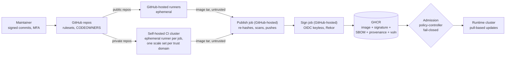

# Target architecture (architectural goal)

Status: **binding goal**, adopted 2026-11-09 (D-40), restated 2026-11-13 (D-45). Owner: @pascal05. The infrastructure goal (IDs `H-*`) lives in
the operator's private infrastructure repository.

A PR that moves away from a goal needs a decision in [decisions.md](decisions.md) naming the goal ID. Current state
is in the [README](../README.md) and `docs/*.md`. The tasks that lead to the goals are in the operator's private
roadmap, in stages with a fixed order and no dates (D-45).

Constraints: **zero cost** (GitHub Free organisation, free/open-source tools, own hardware), **one maintainer**,
**security as strict as these allow**.

## 1. Principles

Canonical here; the infrastructure goal inherits them.

| ID | Principle | Consequence |
|---|---|---|
| P1 | **Fail closed** | A missing signature, attestation, check result or policy match blocks; no "warn and continue" for trust decisions. |
| P2 | **Everything that runs is signed or pinned** | Own images: keyless signature from this pipeline. Third-party images and actions: immutable digest/SHA in git. |
| P3 | **Trust is an identity, not a location** | Consumers trust "built by `build-container.yml` of this repo, from `main`, via GitHub OIDC", never a registry, tag or network. |
| P4 | **Separate trust domains** | Public code never runs on own hardware; private repos build on ephemeral runners per trust domain; CI and runtime never share a cluster. |
| P5 | **Least privilege by default** | `permissions: {}` per workflow, scoped per job; short-lived (OIDC) tokens; no long-lived cloud keys. |
| P6 | **Git is the source of truth** | Policies, pins, manifests and settings expectations are in git and reviewed; live state is checked for drift. |
| P7 | **Evidence over assertion** | Every release carries signature, SBOM, provenance and vulnerability scan bound to the image digest. |
| P8 | **One place for tools and policy** | Scanners, thresholds and exceptions live here; callers pin a release commit and add nothing. |
| P9 | **Exceptions expire** | Every exception has an owner, reason and expiry date; expired ones are reported. |
| P10 | **Free and reproducible over clever** | Prefer platform features and open-source tools; document manual steps; automate what repeats. |

## 2. Trust domains

| Domain | Runs | May hold | Must never |
|---|---|---|---|
| Public CI | Public repos, GitHub-hosted | `GITHUB_TOKEN` (read), OIDC for signing | Run on own hardware; read private packages beyond read access |
| Private CI | Private repos, ephemeral self-hosted runners | Read token for the private toolbox | Reach the LAN, the cluster API or another domain's cache |
| Publish | Separate GitHub-hosted job (D-43) | `GITHUB_TOKEN` with `packages: write` | Execute repo code or Dockerfiles; trust a digest or tag from the build job |
| Signing | Separate GitHub-hosted job | OIDC token for Fulcio | Execute repo code or Dockerfiles |
| Registry | GHCR | Images, signatures, attestations | Be trusted by itself (P3) |
| Runtime | Consumers (app cluster) | Read-only pull credentials | Accept anything that fails the deploy contract (4.5) |

## 3. Reading the goal tables

Status: **Done**, **Merged** (on `main`, ships next release), **Partial**, **Planned**, **Accepted risk** (section 6).
"Verify" is the evidence for re-checking a goal.

## 4. Goal states

### 4.1 Source and repository governance

| ID | Goal | Verify | Status |
|---|---|---|---|
| G-S1 | Public repos: default branch protected by a ruleset (PR, no force-push/deletion, check `security-gate`, strict checks, stale approvals dismissed, conversations resolved, signed commits) | `gh api repos/<r>/rulesets/<id>`; `fleet-drift.yml` | Done (approvals = 0, section 6) |
| G-S2 | `CODEOWNERS` in every repo covering `.github/`, `toolbox/`, `renovate/`, admission policies | file present | Partial (present in 5 of 10 repos checked 2026-11-11; missing in 5 callers; informational only, no ruleset requires code-owner review) |
| G-S3 | Release tags `v*` signed and immutable (tag ruleset, immutable releases) | `git tag -v vX.Y.Z`; release settings | Partial (tag ruleset incl. required signatures is live; immutable releases are off (owner setting); v3.3.0 is an unsigned lightweight tag, D-44) |
| G-S4 | Org allows only GitHub-owned actions, `Pascal-Organisation/*` and an explicit list; every `uses:` pinned to a full SHA | `gh api orgs/<org>/actions/permissions` | Done |
| G-S5 | Fork PRs from external contributors need approval before CI | repo Actions settings | Done |
| G-S6 | Push protection on public repos; TruffleHog on every push/PR, full history weekly | settings, `ci.yml` | Done |
| G-S7 | `SECURITY.md` and private vulnerability reporting | repo settings | Done |
| G-S8 | Weekly drift check of org/repo settings against `fleet/repos.json`, alert on drift | `fleet-drift.yml` runs | Partial (workflow and script exist; it has never run: the secret `FLEET_DRIFT_TOKEN` is not set and the first schedule is 2026-11-16; run locally on 2026-11-11 the script reports 6 differences, see G-C5) |
| G-S9 | Organisation requires 2FA | org settings | Partial (the sole member has 2FA; the organisation requirement setting reads disabled on 2026-11-11) |
| G-S10 | Rulesets cover every branch of this repository (signed commits, no force-push), so no unreviewed commit can become a builder identity | `gh api repos/<r>/rulesets` | Planned (the ruleset covers only the default branch; a commit on any branch satisfies the signer pattern consumers accept today) |
| G-S11 | GitHub Apps installed on the organisation have access to selected repositories only and hold no write permission they do not use | `gh api orgs/<org>/installations` | Planned (two apps hold contents and workflows write on all repositories, 2026-11-13) |

### 4.2 CI execution

| ID | Goal | Verify | Status |
|---|---|---|---|
| G-C1 | Public repos build only on GitHub-hosted runners; `ci.yml` refuses self-hosted for them | `ci.yml` visibility gate; runner groups | Done |
| G-C2 | Private repos build on ephemeral single-job runners; one scale set and namespace per trust domain | ARC config, runner group repo lists | Done (namespace and scale set per trust domain, 2026-11-09) |
| G-C3 | Runner pods: no Docker daemon, privileged mode or host mounts; user namespaces; rootless builds | runner pod spec | Done (rootless BuildKit: the default scale set uses Localhost AppArmor and seccomp profiles, the others stay unconfined, section 6) |
| G-C4 | Runner network default-deny; egress only DNS + public 443/80 | NetworkPolicy, probe matrix | Done (probe matrix OK 2026-11-09) |
| G-C5 | Every workflow starts with `permissions: {}`; org token read-only; Actions cannot approve PRs | zizmor, org settings | Partial (workflows: Done; org settings: on 2026-11-11 the default workflow token is `write` and Actions may approve PRs, against the declared `read` / `false` in `fleet/repos.json`; every workflow still declares `permissions: {}`) |
| G-C6 | No `pull_request_target`/`workflow_run` with untrusted checkout; `persist-credentials: false`; `timeout-minutes` everywhere; no expression injection | zizmor | Done |
| G-C7 | No caches shared across runs or trust domains; fresh BuildKit state per build | workflow review | Done |

### 4.3 Build and gates

| ID | Goal | Verify | Status |
|---|---|---|---|
| G-B1 | One required check `security-gate` aggregating workflow lint + security, secrets, SAST, Trivy, hadolint (checks: [README](../README.md#what-each-run-guarantees)) | `ci.yml` | Done (v3.1.0) |
| G-B2 | Fixable HIGH/CRITICAL blocks, unfixable reported; licence deny-list (AGPL/GPL-3/SSPL) blocks | job summaries | Done (v3.2.0, D-42) |
| G-B3 | Public PRs: dependency review blocks new high-severity dependencies | `ci.yml` | Done (v3.1.0) |
| G-B4 | Lockfiles with hashes, base images by digest (Renovate), OS updates at build | Dockerfiles, Renovate | Partial (per repo) |
| G-B5 | Renovate: 7-day cooldown, 0 days for security fixes, automerge only after the age and checks | `renovate/default.json` | Done (the grouping of image and policy bumps lives in the consumer's own Renovate config; the preset has no rule for own images, which it disables) |
| G-B6 | Public repos: open code scanning alerts of severity high or above block the merge (ruleset rule); Semgrep rules are pinned in the toolbox instead of fetched at run time | ruleset `code_scanning` rule; `toolbox/` | Planned (CodeQL uploads SARIF but does not gate; `p/default` is fetched unpinned) |

### 4.4 Artifacts and evidence

| ID | Goal | Verify | Status |
|---|---|---|---|
| G-A1 | Every image signed keyless by digest in a separate GitHub-hosted job; logged in Rekor | `cosign verify` | Done |
| G-A2 | CycloneDX SBOM of the exact scanned image, attested | `cosign verify-attestation --type cyclonedx` | Done |
| G-A3 | SLSA v1 provenance from the sign job (OIDC claims + digest), cross-checked against the run context; `runner_environment` describes the build job, not the sign job | [provenance.md](provenance.md) | Partial (provenance from the sign job: Done since v3.1.0; `runner_environment` is taken from the sign job, so builds on self-hosted runners are labelled hosted; platform attestations are G-A8) |
| G-A4 | Vulnerability scan attested (`cosign-vuln`) for every release | `cosign verify-attestation --type vuln` | Done (v3.1.0) |
| G-A5 | SBOMs re-evaluated continuously (Dependency-Track), EPSS visible | DT project per image | Done (reporting only) |
| G-A6 | **SLSA Build L3**: provenance from an isolated generator the build cannot influence | n/a | Planned (stretch) |
| G-A7 | Reproducible builds (`SOURCE_DATE_EPOCH`, pinned inputs) | rebuild + diff | Planned (stretch) |
| G-A8 | **SLSA Build L2 for public repos**: provenance generated by the platform (GitHub artifact attestations), build inputs (`context`, `dockerfile`, `target`) and base image digests recorded; consumers accept only reviewed builder commits (deploy contract item 1). Private repos stay at L1 plus signature (section 6) | `gh attestation verify`; [provenance.md](provenance.md) | Planned (v4.0.0; today Build L1 is met completely, L2 is not) |

### 4.5 Deploy contract

A runtime may run an own image only if **all** of these hold; otherwise it refuses (P1):

1. Signature: keyless, issuer `https://token.actions.githubusercontent.com`, subject
   `https://github.com/Pascal-Organisation/security-pipeline/.github/workflows/build-container.yml@<SHA>`, where
   `<SHA>` is the commit of a signed release tag of this repository. The consumer keeps that list in git and
   generates it from the tags (D-45; until the consumer has switched, any 40-hex SHA is accepted, D-5).
2. Provenance attestation: `externalParameters.workflow.repository` = the app's repo, `ref` = `refs/heads/main`;
   from v3.1.0 also `builder.id` = the reusable workflow at a pinned SHA, and event `push`.
3. CycloneDX SBOM attestation present.
4. From v3.1.0 plus policy rollout: vulnerability attestation present.
5. Third-party images: exact digest listed in git; nothing else.
6. Images referenced by digest; tags are informational.

| ID | Goal | Verify | Status |
|---|---|---|---|
| G-D1 | Items 1-3, 5, 6 enforced at admission, fail-closed, no match = deny | ClusterImagePolicies | Partial (items 2, 3, 5, 6 and the workflow identity are enforced, fail-closed; item 1 as restated by D-45 is open: consumers accept any 40-hex commit of `build-container.yml`, including commits on unmerged branches) |
| G-D2 | Item 2 (builder.id, event) and item 4 enforced | ClusterImagePolicies | Done (app cluster, 2026-11-09) |
| G-D3 | Pull-based deploys; CI never holds runtime credentials | updater design | Done |
| G-D4 | Runtime manifests reconciled from git (GitOps) | live state vs git | Partial (a GitOps controller reconciles every app-cluster unit from `main` since 2026-11-11; commits are not signature-verified and pruning is off, so the stretch goal of signed GitOps is open) |

### 4.6 Vulnerability and exception management

| ID | Goal | Verify | Status |
|---|---|---|---|
| G-V1 | Remediation SLAs: Critical 7 d, High 30 d, Medium 90 d | [decisions.md](decisions.md) (D-36) | Done |
| G-V2 | Exceptions only in `.security/exceptions.json` (`id`, `kind`, `reason`, `owner`, `expires`); `owner` required; an exception is valid for at most 90 days; expired ones reported | `ci.yml` | Partial (v3.1.0: schema, expiry report; `owner` only warns and there is no maximum validity; both required in v4.0.0) |
| G-V3 | Not-affected findings as OpenVEX, applied to all scans | `.security/vex.openvex.json` | Done (v3.1.0) |
| G-V4 | Running images re-scanned weekly | in-cluster job | Done (weekly CronJob in the app cluster since 2026-11-09; first scheduled run 2026-11-15) |
| G-V5 | Findings carry KEV and EPSS, and the fix order follows them inside the SLAs of G-V1 | scan summary, Dependency-Track | Planned |

### 4.7 Release and operations

| ID | Goal | Verify | Status |
|---|---|---|---|
| G-R1 | Release order: merge, signed annotated tag, GitHub Release, consumer's list of builder commits regenerated from the tags (automated, no hand edit), caller pin bumps | [release.md](release.md) | Partial (order documented; v3.3.0 was released before its tag was signed, D-44; the consumer list is not generated yet because any SHA is trusted, D-5) |
| G-R2 | Toolbox image private, digest-pinned, rebuilt and signed by `toolbox.yml`; the digest the workflows use is at most 14 days behind the toolbox built from `main` | GHCR | Partial (private, pinned, signed: Done; the workflows still use the digest of 2026-11-04 because the Renovate preset disables the organisation's own images) |
| G-R3 | OpenSSF Scorecard weekly, public | `scorecard.yml` | Done |
| G-R4 | Security-relevant org settings declared in `fleet/repos.json` | `fleet-drift.yml` | Done |
| G-R5 | Every caller pins the newest release within 7 days of its publication; `fleet-drift.yml` reports older pins and references to reusable workflows that no longer exist | `fleet-drift.yml` report | Planned (2026-11-13: 6 of 9 callers on v3.2.0; two callers reference a removed workflow and their weekly scan fails) |
| G-R6 | Scheduled scans cannot be cancelled by pushes (the caller template excludes `schedule` from `cancel-in-progress`), and the weekly full scan of every caller succeeds within its interval | caller workflows; run history | Planned (2026-11-13: weekly runs cancelled by pushes in two callers) |

## 5. Invariants

Never: run public-repo code on own hardware; sign, attest or push from a job that runs repo code with the signing
identity; trust a tag, registry or network location instead of the signer identity; pin by mutable tag; add a scanner,
threshold or exception in a caller repo; store a long-lived credential where an OIDC token works; disable a gate to
ship (use a time-limited, owned exception).

## 6. Accepted risks and non-goals

| Item | Why accepted | Compensating control | Revisit |
|---|---|---|---|
| 0 required approvals | Single maintainer; no self-approval | Rulesets, signed commits, CODEOWNERS, release policy | Second maintainer or review bot |
| Private repos without CodeQL, GitHub secret scanning, artifact attestations | Paid features | Semgrep, Bandit, TruffleHog, cosign attestations | If plans change |
| Rootless BuildKit needs relaxed seccomp/AppArmor (default scale set: custom Localhost profiles; other scale sets: unconfined) | No free sandbox works on the CI hardware (nested Kata failed) | Ephemeral pod, user namespaces, no privileges, network policy, separate cluster | When the other scale sets get the custom profiles |
| SLSA Build L1 plus signature for private repos (public repos: L2 is a goal, G-A8) | Platform provenance needs Enterprise | Provenance from OIDC claims in a separate sign job | L3 milestone |
| Dependency-Track reporting only | Build gate is Trivy | SLAs, weekly re-scan | n/a |

## 7. Maturity levels

Status as of v3.3.0 (see `VERSION`, [decisions.md](decisions.md), tags v3.0.2 to v3.3.0).

| Level | Meaning | Status |
|---|---|---|
| **L1 Baseline** | Signed images, SBOM, fail-closed admission, pinned actions, gates | Reached (v3.0.x, 2026-11-04) |
| **L2 Hardened** | Nothing unreviewed can sign or be admitted: G-S1 to G-S11, G-C1 to G-C7, G-B1 to G-B3, G-B5, G-A1 to G-A5, G-D1 to G-D3, G-V1 to G-V3, G-R1, G-R3, G-R4 | Not yet reached. Open: G-S2, G-S3, G-S8, G-S9, G-S10, G-S11, G-C5, G-D1 (builder commits), G-R1 |
| **L3 Verified** | Evidence beyond prevention: SLSA Build L2 for public repos (G-A8), code scanning gate (G-B6), exceptions with owner and 90 days (G-V2), KEV/EPSS (G-V5), fresh toolbox and fleet (G-R2, G-R5, G-R6), signed GitOps (G-D4), Scorecard KPI; stretch: G-A6, G-A7 | Done: licence gate (D-42), weekly runtime re-scan (G-V4). Open: the rest |

## 8. KPIs

| KPI | Target | Measured 2026-11-11 |
|---|---|---|
| Own images running that pass the full deploy contract | 100 % | Not measured here (admission enforces it for the three image policies) |
| Actions/images referenced by mutable tag | 0 | 0 `uses:` in this repo's workflows without a full SHA |
| Open fixable Critical/High past SLA | 0 | Not measured |
| Expired exceptions | 0 | Not measured |
| `fleet-drift.yml` | green every week | Never run (secret missing) |
| OpenSSF Scorecard (this repo) | >= 7.5 (D-45; 8.0 cannot be reached by one maintainer: Code-Review and Contributors score 0 by construction, Fuzzing has no target). Per check: License, Security-Policy, Branch-Protection (linear history) and the OpenSSF Best Practices badge to their maximum; Maintained resolves with repository age | 6.4 (2026-11-13) |
| Callers behind the newest release for more than 7 days | 0 | 6 of 9 (2026-11-13) |
| Weekly full scan succeeded in every caller with a weekly schedule | 100 % | 4 of 8 (week of 2026-11-09: two failed at start, two were cancelled by pushes) |
| Age of the toolbox digest used by the workflows | <= 14 days behind `main` | digest of 2026-11-04 in use while `main` pins newer scanner versions (2026-11-13) |
| Security fix available to released image | within SLA; Renovate security PRs merged within 48 h | Not measured |

## 9. Governance

- **Change control:** a PR touching workflows, policies, `renovate/` or `fleet/` names the goal IDs it affects.
  Moving away from a goal needs a decision `D-<n>` referencing the goal ID.
- **Drift:** `fleet-drift.yml` weekly; the infrastructure repository checks live vs git for the runtime.
- **Re-audit:** quarterly, compare the goal tables with live state (read-only), update statuses.
- **This document:** status changes go in the PR that delivers them; goal changes need a decision.
